# pom2games

**New games for the Apple II — motocross, survival, brick-breakers, dungeons,
pinball and more, on bootable disks you can play today.**

  

pom2games is a collection of Apple II programs written in 6502 assembly and C,
for the [POM2](https://github.com/habib256/pom2) emulator or a real Apple II+,
//e or //c. Many started life as sketches for
[POM1](https://github.com/habib256/pom1) and were rebuilt around the Apple II's
own hi-res and double hi-res screens; others are fresh games or faithful
rebuilds of classics. Everything is free software (GPL-3.0), and every disk
boots straight into its program.

## Play in 30 seconds

1. **Grab a disk**: from the [Releases](https://github.com/habib256/pom2games/releases)
   page, or any image in [`dist/`](dist/) (each game below has a direct link).
   `.dsk` files are 140 KB DOS 3.3 floppies; `.po` files are ProDOS volumes.
2. **Boot it in an emulator**: [POM2](https://github.com/habib256/pom2), or
   AppleWin, MAME, Virtual ][ or any Apple II emulator. Pick an Apple II+ (or
   later) for the DOS 3.3 games, an enhanced //e with 128 KB for the ProDOS
   ones.
3. **Or on real hardware**: write the image to a floppy, or load it on a floppy
   emulator (Disk II / SmartPort) and power on.
   **MiSTer** (Apple-II core): take the `.woz` twin in [`dist/woz/`](dist/woz/),
   not the `.dsk`/`.po` — the core's own conversion breaks the games that read
   the disk after starting, and it saves back to WOZ images only.

That's it: there is nothing to type, the game starts by itself.

**Even quicker**: every game below has a **▶ in browser** link that boots its
disk straight from `dist/` in [POM2 for the web](https://habib256.github.io/pom2/wasm/),
on the right machine — nothing to download or install.

## The games

| | Game | Machine | Disk | Play |
|---|---|---|---|---|
| 🏍️ | [DIRTBIKE](#dirtbike) — side-view motocross | Apple II+ 48 KB | [release 1.0](https://github.com/habib256/pom2games/releases/tag/dirtbike-1.0) | [▶ in browser](https://habib256.github.io/pom2/wasm/?preset=ii%2B&url=https://raw.githubusercontent.com/habib256/pom2games/main/dist/DIRTBIKE.dsk) |
| 👾 | [WARGALAGA II](#wargalaga-ii) — Warblade-style shoot'em up | //e enhanced or //c, 128 KB | [`WARGALAGAII.po`](https://github.com/habib256/pom2games/raw/main/dist/WARGALAGAII.po) | [▶ in browser](https://habib256.github.io/pom2/wasm/?preset=iie&url=https://raw.githubusercontent.com/habib256/pom2games/main/dist/WARGALAGAII.po) |
| 🏔️ | [NEOWILDERNESS XL](#neowilderness-xl) — wilderness survival in 16 colours | //e enhanced or //c, 128 KB | [`NEOWILDERNESSXL.po`](https://github.com/habib256/pom2games/raw/main/dist/NEOWILDERNESSXL.po) | [▶ in browser](https://habib256.github.io/pom2/wasm/?preset=iie&url=https://raw.githubusercontent.com/habib256/pom2games/main/dist/NEOWILDERNESSXL.po) |
| 🌈 | [CHROMABREAK](#chromabreak) — 16-colour brick-breaker | //e enhanced or //c, 128 KB | [release 1.0](https://github.com/habib256/pom2games/releases/tag/chromabreak-1.0) | [▶ in browser](https://habib256.github.io/pom2/wasm/?preset=iie&url=https://raw.githubusercontent.com/habib256/pom2games/main/dist/CHROMABREAK.po) |
| 🧱 | [ARKABREAKOUT](#arkabreakout) — brick-breaker | Apple II+ 48 KB | [`ARKABREAKOUT.dsk`](https://github.com/habib256/pom2games/raw/main/dist/ARKABREAKOUT.dsk) | [▶ in browser](https://habib256.github.io/pom2/wasm/?preset=ii%2B&url=https://raw.githubusercontent.com/habib256/pom2games/main/dist/ARKABREAKOUT.dsk) |
| 💡 | [LIGHT3DBALL](#light3dball) — ball in a 3D corridor | Apple II+ 48 KB | [`LIGHT3DBALL.dsk`](https://github.com/habib256/pom2games/raw/main/dist/LIGHT3DBALL.dsk) | [▶ in browser](https://habib256.github.io/pom2/wasm/?preset=ii%2B&url=https://raw.githubusercontent.com/habib256/pom2games/main/dist/LIGHT3DBALL.dsk) |
| 🐉 | [MAZE3D](#maze3d) — dungeon crawler | Apple II+ 48 KB | [`MAZE3D.dsk`](https://github.com/habib256/pom2games/raw/main/dist/MAZE3D.dsk) | [▶ in browser](https://habib256.github.io/pom2/wasm/?preset=ii%2B&url=https://raw.githubusercontent.com/habib256/pom2games/main/dist/MAZE3D.dsk) |
| 📦 | [MICRO-SOKOBAN](#micro-sokoban) — 454 puzzles | Apple II+ 48 KB | [release 1.2](https://github.com/habib256/pom2games/releases/tag/1.2) | [▶ in browser](https://habib256.github.io/pom2/wasm/?preset=ii%2B&url=https://raw.githubusercontent.com/habib256/pom2games/main/dist/MICRO-SOKOBAN.dsk) |
| ♟️ | [CHESS](#chess) — play the computer | Apple II+ 48 KB | [`CHESS.dsk`](https://github.com/habib256/pom2games/raw/main/dist/CHESS.dsk) | [▶ in browser](https://habib256.github.io/pom2/wasm/?preset=ii%2B&url=https://raw.githubusercontent.com/habib256/pom2games/main/dist/CHESS.dsk) |
| 🎯 | [PINBALL](#pinball) — Pinball Construction Set | Apple II+ 48 KB or //c | [`PINBALL.dsk`](https://github.com/habib256/pom2games/raw/main/dist/PINBALL.dsk) | [▶ in browser](https://habib256.github.io/pom2/wasm/?preset=ii%2B&url=https://raw.githubusercontent.com/habib256/pom2games/main/dist/PINBALL.dsk) |
| 🎵 | [MCS](#mcs) — music editor | Apple II+ 48 KB | build it: `make -C mcs` | — |
| 🐢 | [LOGO](#logo) — turtle graphics | //e (80 col.) or II+ (40 col.) | [`LOGO.dsk`](https://github.com/habib256/pom2games/raw/main/dist/LOGO.dsk) | [▶ in browser](https://habib256.github.io/pom2/wasm/?preset=iie&url=https://raw.githubusercontent.com/habib256/pom2games/main/dist/LOGO.dsk) |
| 🐍 | [SNAKE](#snake) — the classic | Apple II+ 48 KB | [`SNAKE.dsk`](https://github.com/habib256/pom2games/raw/main/dist/SNAKE.dsk) | [▶ in browser](https://habib256.github.io/pom2/wasm/?preset=ii%2B&url=https://raw.githubusercontent.com/habib256/pom2games/main/dist/SNAKE.dsk) |

---

### DIRTBIKE

<table><tr>
<td>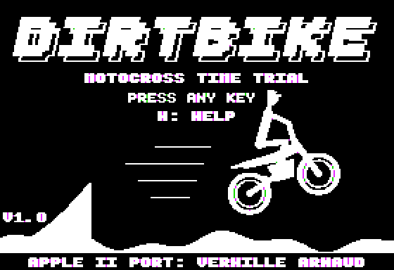</td>
<td></td>
</tr></table>

Throttle, lean, fly! 🏍️ A side-view motocross against the clock, inspired by
Brad Quick's *Dirt Bike* on the Macintosh: **30 tracks of 3 laps**, from very
easy to very hard, with real Verlet physics and pixel-smooth HGR scrolling.
Jumps and flips score points — but land on your wheels, or the rider eats dirt.
Best times and scores stay on the disk.

- **Machine**: Apple II+ 48 KB, DOS 3.3
- **Controls**: joystick (analog lean, button 0 throttle, button 1 brake) or
  keyboard (←/→ lean, A/Z throttle, Space brake)
- **Play**: [▶ in your browser](https://habib256.github.io/pom2/wasm/?preset=ii%2B&url=https://raw.githubusercontent.com/habib256/pom2games/main/dist/DIRTBIKE.dsk) (POM2, nothing to install)
- **Download**: [DIRTBIKE 1.0](https://github.com/habib256/pom2games/releases/tag/dirtbike-1.0)
  · [`dist/DIRTBIKE.dsk`](https://github.com/habib256/pom2games/raw/main/dist/DIRTBIKE.dsk)
  · [more](dirtbike/README.md)

### WARGALAGA II

<table><tr>
<td></td>
<td></td>
</tr></table>

A fixed shooter in the spirit of **Warblade** 👾, at 30 frames per second in
HGR: 40 aliens enter in waves, settle in a breathing formation, then dive and
bomb; 32 falling bonuses (speed, bullets, time, double and triple shot,
shield, freeze…), 100 levels with big aliens, flypast, kamikaze waves and a
boss every 25, a shop every 4 levels, two sub-games (Meteor Storm, Memory
Station), PT3 music on a Mockingboard or effects on the speaker. Left alone,
the title runs a one-minute demo; the 8 best scores are saved on the disk.

- **Machine**: Apple //e enhanced or //c, 128 KB, ProDOS 8 (140 KB disk), Mockingboard optional
- **Controls**: keyboard or joystick
- **Play**: [▶ in your browser](https://habib256.github.io/pom2/wasm/?preset=iie&url=https://raw.githubusercontent.com/habib256/pom2games/main/dist/WARGALAGAII.po) (POM2, nothing to install)
- **Download**: [`dist/WARGALAGAII.po`](https://github.com/habib256/pom2games/raw/main/dist/WARGALAGAII.po)
  · [more](wargalagaii/README.md)

### NEOWILDERNESS XL

<table><tr>
<td></td>
<td>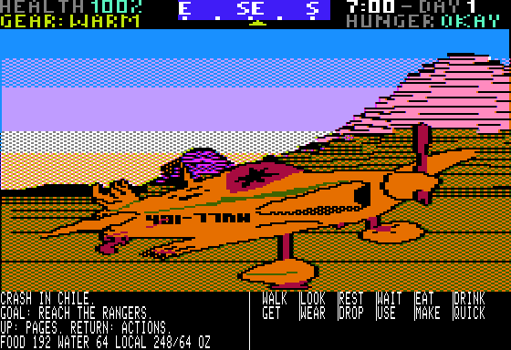</td>
</tr><tr>
<td>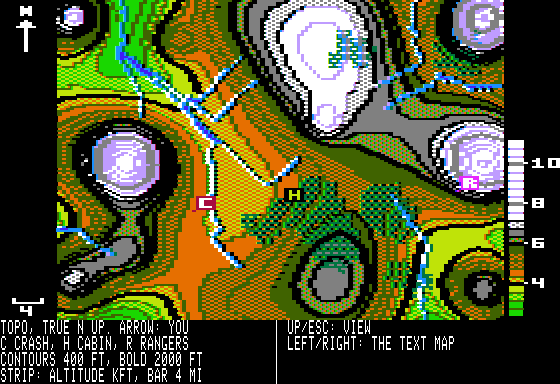</td>
<td>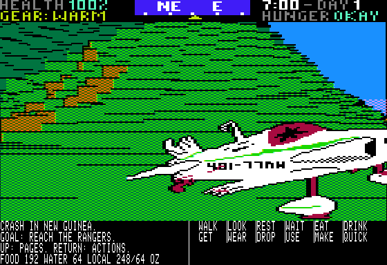</td>
</tr></table>

Your plane is down. The rangers are far away. 🏔️ *Wilderness: A Survival
Adventure* (Electric Transit, 1985) reborn in **16-colour double hi-res**:
the original 3D landscape engine, now with a sky that follows the sun and the
Moon (golden hour, sunset, twilight, moonlit nights), the original sprites in
colour, and a modern interface — compass ribbon, survival gauges, 80-column
messages, a TOPO map and a scrolling local MAP. Six journeys (Sierra Nevada,
British Columbia, Burma, New Guinea, Bolivia, Chile), ten difficulty levels,
five save slots and a hall of fame. Walk, swim, hunt, build a fire, boil
water, treat your wounds… and make it out alive.

- **Machine**: Apple //e enhanced or //c, 128 KB, ProDOS 8, on an
  **800 KB 3.5" volume** (SmartPort drive or floppy emulator)
- **Controls**: arrow keys and RETURN to browse the pages and the action
  grid, or type commands as in the original (`WALK`, `LOOK`, `EAT`, `TOPO`…)
- **Play**: [▶ in your browser](https://habib256.github.io/pom2/wasm/?preset=iie&url=https://raw.githubusercontent.com/habib256/pom2games/main/dist/NEOWILDERNESSXL.po) (POM2, nothing to install)
- **Download**: [`dist/NEOWILDERNESSXL.po`](https://github.com/habib256/pom2games/raw/main/dist/NEOWILDERNESSXL.po)
  · [more](neowilderness/README.md) (in French)

*Under the hood*: Neowilderness grew out of [`wilderness/`](wilderness/), a
140 KB reimplementation of the original for the Apple II+ 48 KB under DOS 3.3
in HGR. On the tested journeys, the XL simulation state matches that
reference byte for byte; the II+ disk is built in `wilderness/build/` and is
not shipped in `dist/`.

### CHROMABREAK

<table><tr>
<td>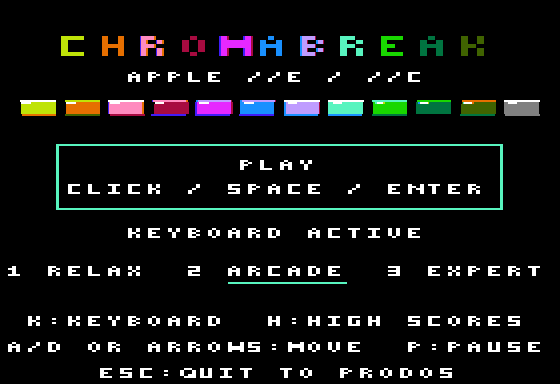</td>
<td>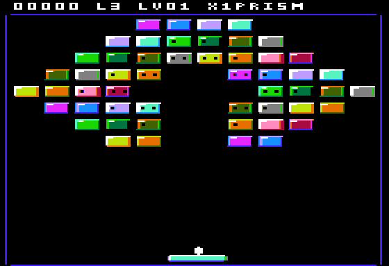</td>
</tr></table>

A brick-breaker in **16 colours at 30 frames per second** 🌈: 60 hand-drawn
sectors (INVADERS, PACMAN, SKULL, CASTLE…), six Arkanoid-style capsules
(laser, three balls, pierce…), two enemies, combos up to ×8 and two-voice
music on the one-bit speaker. Fireworks wait after sector 60.

- **Machine**: Apple //e enhanced or //c, 128 KB, ProDOS 8 (140 KB disk)
- **Controls**: AppleMouse II, keyboard, joystick or paddles
- **Play**: [▶ in your browser](https://habib256.github.io/pom2/wasm/?preset=iie&url=https://raw.githubusercontent.com/habib256/pom2games/main/dist/CHROMABREAK.po) (POM2, nothing to install)
- **Download**: [ChromaBreak 1.0](https://github.com/habib256/pom2games/releases/tag/chromabreak-1.0)
  · [`dist/CHROMABREAK.po`](https://github.com/habib256/pom2games/raw/main/dist/CHROMABREAK.po)
  · [more](chromabreak/README.md)

### ARKABREAKOUT

<table><tr>
<td>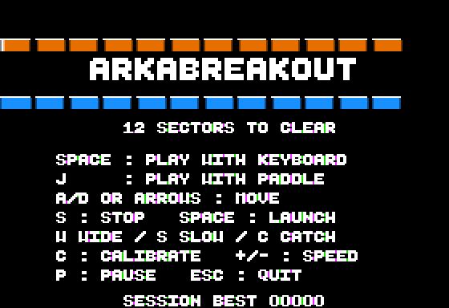</td>
<td>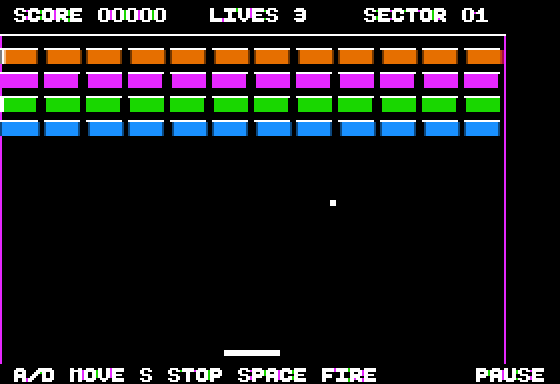</td>
</tr></table>

ChromaBreak's gameplay squeezed into a **48 KB Apple II+** in HGR: the same 60
boards, six capsules, enemies, combos, three difficulty levels and five
high scores saved on the disk. 🧱

- **Machine**: Apple II+ 48 KB, DOS 3.3
- **Controls**: joystick, paddles, AppleMouse II card or keyboard
- **Play**: [▶ in your browser](https://habib256.github.io/pom2/wasm/?preset=ii%2B&url=https://raw.githubusercontent.com/habib256/pom2games/main/dist/ARKABREAKOUT.dsk) (POM2, nothing to install)
- **Download**: [`dist/ARKABREAKOUT.dsk`](https://github.com/habib256/pom2games/raw/main/dist/ARKABREAKOUT.dsk)
  · [more](arkabreakout/README.md)

### LIGHT3DBALL

<table><tr>
<td>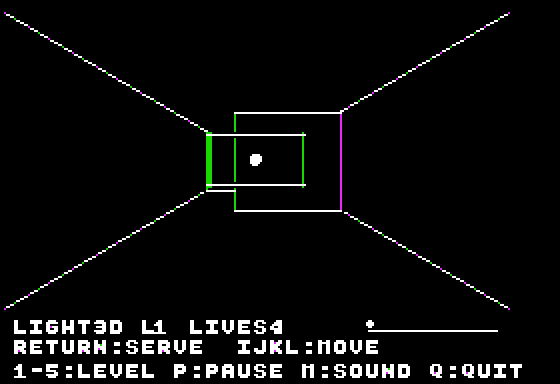</td>
<td>

An original game inspired by *The Light Corridor* 💡: keep a ball in play down
a 3D corridor with your paddle, slip through sliding doors and hit the target
on the far wall. Five long levels in double-buffered HGR.

- **Machine**: Apple II+ 48 KB, DOS 3.3
- **Controls**: AppleMouse, or keyboard (IJKL / arrows, RETURN to serve)
- **Play**: [▶ in your browser](https://habib256.github.io/pom2/wasm/?preset=ii%2B&url=https://raw.githubusercontent.com/habib256/pom2games/main/dist/LIGHT3DBALL.dsk) (POM2, nothing to install)
- **Download**: [`dist/LIGHT3DBALL.dsk`](https://github.com/habib256/pom2games/raw/main/dist/LIGHT3DBALL.dsk)
  · [more](light3dball/README.md) (in French)

</td>
</tr></table>

### MAZE3D

<table><tr>
<td>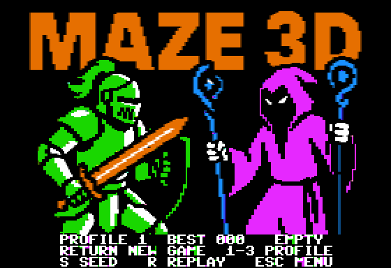</td>
<td></td>
</tr></table>

A wire-frame dungeon crawler in the Wizardry mould 🐉: three generated floors,
goblins, orcs, dark mages and a final dragon, turn-based combat, a shop
between floors and three profiles. Your best run is saved, so the next player
can replay the very same dungeon.

- **Machine**: Apple II+ 48 KB, DOS 3.3
- **Controls**: joystick or keyboard (IJKL to move, M map, P potion, H help)
- **Play**: [▶ in your browser](https://habib256.github.io/pom2/wasm/?preset=ii%2B&url=https://raw.githubusercontent.com/habib256/pom2games/main/dist/MAZE3D.dsk) (POM2, nothing to install)
- **Download**: [`dist/MAZE3D.dsk`](https://github.com/habib256/pom2games/raw/main/dist/MAZE3D.dsk)
  · [more](maze3d/README.md)

### MICRO-SOKOBAN

<table><tr>
<td>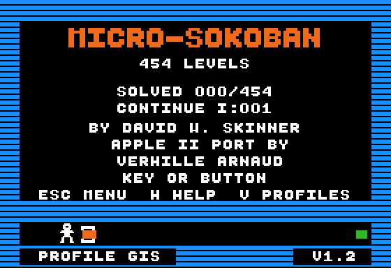</td>
<td>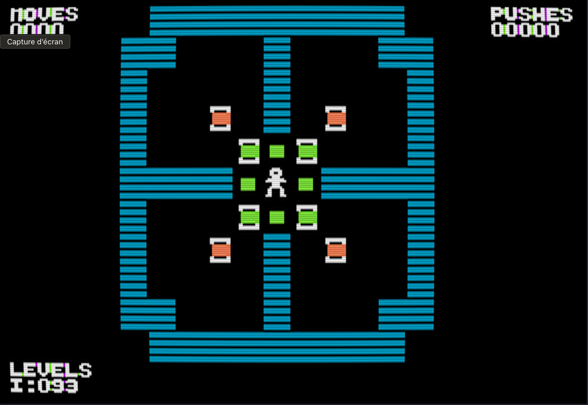</td>
</tr></table>

Push the crates, mind the corners 📦: a five-lesson tutorial, then **454
Microban puzzles** by David W. Skinner (Microban I to IV). Ten profiles,
undo/redo, resume anywhere, a Hall of Fame and a two-voice jazz tune.

- **Machine**: Apple II+ 48 KB, DOS 3.3
- **Controls**: joystick or keyboard (IJKL, WASD or arrows)
- **Play**: [▶ in your browser](https://habib256.github.io/pom2/wasm/?preset=ii%2B&url=https://raw.githubusercontent.com/habib256/pom2games/main/dist/MICRO-SOKOBAN.dsk) (POM2, nothing to install)
- **Download**: [MICRO-SOKOBAN 1.2](https://github.com/habib256/pom2games/releases/tag/1.2)
  · [`dist/MICRO-SOKOBAN.dsk`](https://github.com/habib256/pom2games/raw/main/dist/MICRO-SOKOBAN.dsk)
  · [more](micro-sokoban/README.md)

### CHESS

<table><tr>
<td>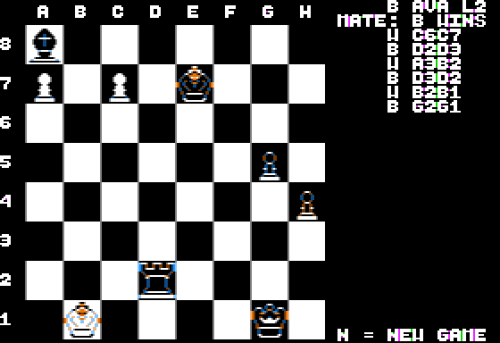</td>
<td>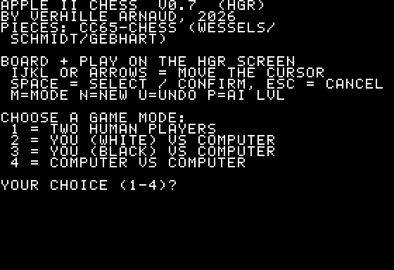</td>
</tr></table>

Chess on the HGR screen ♟️ against the computer (three levels, 1 to 3 plies),
between two players, or computer against computer. Castling, en passant,
promotion, draws by rule, a move list and undo. Pieces from cc65-Chess.

- **Machine**: Apple II+ 48 KB, DOS 3.3
- **Controls**: keyboard (IJKL or arrows, Space to pick and drop, U undo)
- **Play**: [▶ in your browser](https://habib256.github.io/pom2/wasm/?preset=ii%2B&url=https://raw.githubusercontent.com/habib256/pom2games/main/dist/CHESS.dsk) (POM2, nothing to install)
- **Download**: [`dist/CHESS.dsk`](https://github.com/habib256/pom2games/raw/main/dist/CHESS.dsk)
  · [more](chess/README.md)

### PINBALL

<table><tr>
<td></td>
<td>

**Bill Budge's Pinball Construction Set** (1982) 🎯, rebuilt from the sources
he published: drag bumpers, flippers and targets onto the table, wire the
scoring, hit PLAY, then save your table or MAKE it a stand-alone game. Now
with AppleMouse support.

- **Machine**: Apple II+ 48 KB, or //c with its built-in mouse
- **Controls**: mouse, or joystick / paddles
- **Play**: [▶ in your browser](https://habib256.github.io/pom2/wasm/?preset=ii%2B&url=https://raw.githubusercontent.com/habib256/pom2games/main/dist/PINBALL.dsk) (POM2, nothing to install)
- **Download**: [`dist/PINBALL.dsk`](https://github.com/habib256/pom2games/raw/main/dist/PINBALL.dsk)
  · [more](pinball/README.md) (in French)

</td>
</tr></table>

### MCS

<table><tr>
<td>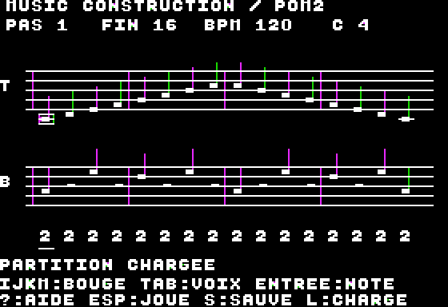</td>
<td>

A music editor inspired by Will Harvey's *Music Construction Set* 🎵: two
staves, four pages of notes, tempo, playback on the speaker and songs saved
on the disk. An original reimplementation, no Electronic Arts code.

- **Machine**: Apple II+ 48 KB, DOS 3.3
- **Controls**: keyboard (IJKM to move, RETURN to place a note, Space to play)
- **Disk**: not shipped in `dist/` yet; build it with `make -C mcs`
  · [more](mcs/README.md) (in French)

</td>
</tr></table>

### LOGO

<table><tr>
<td>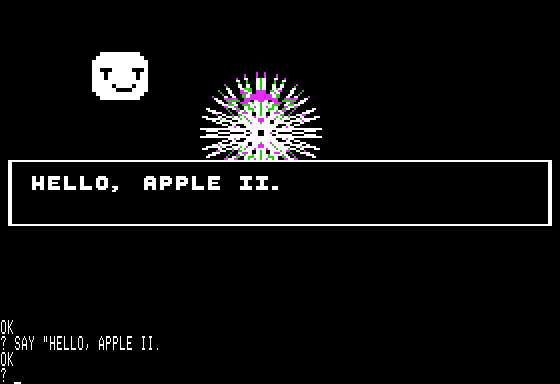</td>
<td>

LOGO V2.6 🐢: turtle graphics on the HGR screen in 16 tints, procedures with
parameters and recursion, emote-shaped turtles and speech bubbles, a
full-screen editor, built-in help and demos. 80 columns on a //e.

- **Machine**: Apple //e (80 columns) or II+ (40 columns), DOS 3.3
- **Controls**: type `REPEAT 36 [FD 60 RT 170]`, then `DEMO`
- **Play**: [▶ in your browser](https://habib256.github.io/pom2/wasm/?preset=iie&url=https://raw.githubusercontent.com/habib256/pom2games/main/dist/LOGO.dsk) (POM2, nothing to install)
- **Download**: [`dist/LOGO.dsk`](https://github.com/habib256/pom2games/raw/main/dist/LOGO.dsk)
  · [more](logo/README.md)

</td>
</tr></table>

### SNAKE

<table><tr>
<td>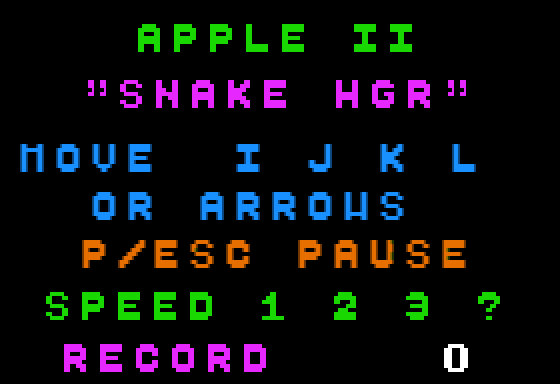</td>
<td>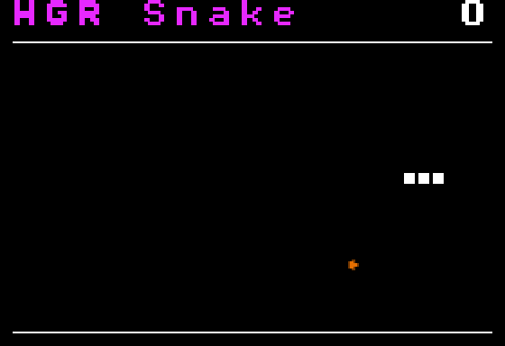</td>
</tr></table>

The classic 🐍: eat apples, grab the bonus gems, don't hit the walls — and
watch it speed up. With sound, three starting speeds and a record saved on
the disk. A whole game in one 10 KB C program (cc65).

- **Machine**: Apple II+ 48 KB, DOS 3.3
- **Controls**: IJKL, arrows or joystick; 1 2 3 on the title for the speed; P to pause
- **Play**: [▶ in your browser](https://habib256.github.io/pom2/wasm/?preset=ii%2B&url=https://raw.githubusercontent.com/habib256/pom2games/main/dist/SNAKE.dsk) (POM2, nothing to install)
- **Download**: [`dist/SNAKE.dsk`](https://github.com/habib256/pom2games/raw/main/dist/SNAKE.dsk)
  · [more](snake/README.md)

---

## For developers

Every game builds from source with [cc65](https://cc65.github.io/) and
Python 3, and the repository depends on no other folder. Each game folder has
its own `README.md` (controls, differences from the original) and a `TODO.md`.

### The shared toolbox: [`dev/`](dev/)

- **Libraries** (`dev/lib`): `apple2` / `apple2c` (keyboard, text, sound,
  joystick, DOS commands, clean exit, in assembly and C), `hgr` (HGR text,
  sprites, tables), `hgrc` and `gfx` (HGR/DHGR C graphics and geometry),
  `math` (multiply, divide, square root, random, decimal), `font` (the
  Beautiful Boot 8x8 font), `prodos` (MLI, SYS exit) and `mouse` (AppleMouse
  II). Their speed/RAM trade-off switches are listed in
  [`dev/lib/ABI.md`](dev/lib/ABI.md).
- **Tools** (`dev/tools`): `a2shot` (headless runs on the POM2 core: typing,
  screenshots, breakpoints — how every game is tested), `a2run` (the same in
  portable C, with disk writes), `a2test.py` (the shared test harness),
  `dos33.py` and `prodos` (disk builders and readers), asset converters.
- **Build glue and examples**: `dev/cc65` (linker configs, C startup,
  `apple2.mk` shared by every program), [`dev/examples/hgr`](dev/examples/hgr/)
  (`dist/HGR.dsk`), [`dev/examples/dhgr`](dev/examples/dhgr/)
  (`dist/DHGR.dsk`), `dev/examples/hello` (a starter in assembly and C), and
  `dev/bench` (performance budgets).

### Build and test

    make                 # every disk, into dist/
    make -C chess        # just one game (it goes into dist/ too)
    make -C chess run    # run it in an installed POM2 (/Applications/POM2.app)
    make test            # fast tier: every program's quick tests + dev/ checks
    make test-changed    # fast tier of only what the working tree changes
                         # (BASE=<ref>, default origin/main; LONG=1 adds the long tier)
    make test-long       # long tier: full campaigns, every level
    make test-all        # both tiers (about an hour)
    make test-<game>     # one game's fast tier (test-<game>-long: its long tier)
    make bench           # measure the primitives (bench-check: against budgets)
    make check           # rebuild everything, fail if dist/ does not match
    make clean           # delete build/ folders (distclean: dist/ images too)

Every program has a fast tier (`make -C <game> test`, a minute or two, the
reflex of the development loop) and a long tier (`test-long`). A new game
follows the same convention (`dev/cc65/apple2.mk`; `wargalagaii/Makefile` is
an example) and joins `TESTED` in the root Makefile.

**Requirements**: cc65 (`brew install cc65` or `apt install cc65`) and
python3; C/C++ compilers and zlib for `make test` (`dev/tools/a2run`, fhpack
tests). The //e and DHGR tests use `dev/tools/a2shot` (macOS arm64 or Linux
x86_64; libslirp via `brew install libslirp` or `apt install libslirp-dev`);
`make test` skips them when it is missing.

**Determinism and CI**: builds are byte-for-byte reproducible — the `dist/`
images made on macOS rebuild identically with Ubuntu 24.04's cc65 2.19.
Continuous integration (`.github/workflows/build.yml`) runs `make check`, then
`make test-all`, on every push: a source change committed without its rebuilt
`dist/` fails the build.

## Licences and credits

Code: GPL-3.0 ([LICENSE](LICENSE)), like POM1 and POM2 from which it derives
(VERHILLE Arnaud).

- Pinball Construction Set: Bill Budge (1982); his published Apple II sources
  are MIT-licensed and kept unmodified in [`pinball/upstream/`](pinball/upstream/).
- Wilderness: A Survival Adventure: Electric Transit (1985), by Wesley
  Huntress, Charles Kohlhase and Peter Farson; original data stays local and
  is not in the repository.
- DIRTBIKE is inspired by *Dirt Bike* by Brad Quick (Macintosh); MCS by
  *Music Construction Set* by Will Harvey; LIGHT3DBALL by *The Light Corridor*.
- Microban levels: David W. Skinner.
- Chess pieces: cc65-Chess by Stefan Wessels, Apple II port by Oliver
  Schmidt, drawings by Frank Gebhart.
- Monster sprites and emotes: SCROLL-O-SPRITES by Quale (CC-BY-3.0).
- 8x8 font: Beautiful Boot, Michael Pohoreski.

The Apple II / //e / Disk II ROMs (`dev/tools/a2shot/roms/`) and the DOS 3.3
system tracks (`dev/tools/dos33_system.bin`, also present on every disk) are
works of Apple Computer, Inc. They are taken from POM2, where they are already
published, so that the repository builds and tests on its own.
`dev/tools/a2shot/sdk/` contains the compiled POM2 core (GPL-3.0; macOS arm64
and Linux x86_64 builds of one POM2 commit, see `dev/tools/a2shot/sdk.mk`).
