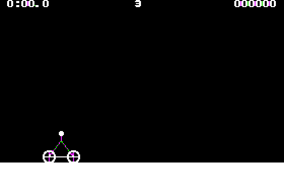
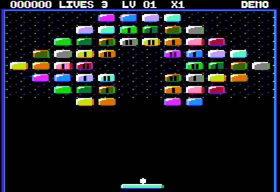
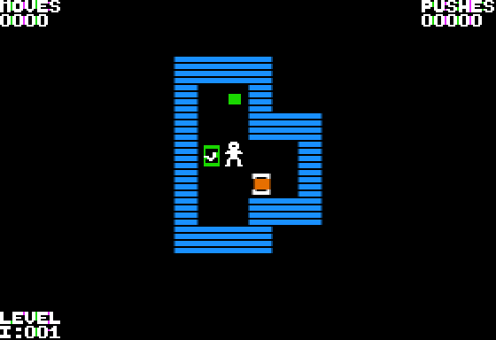
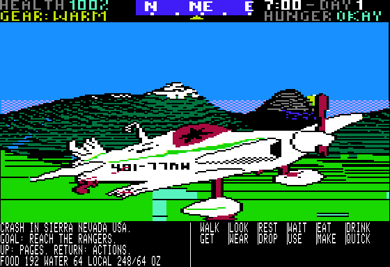
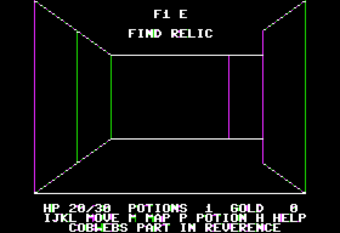
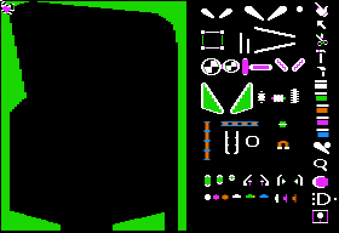
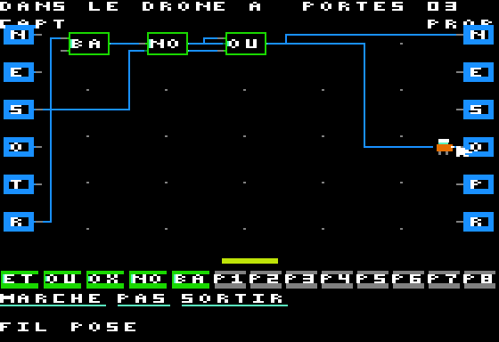

# pom2games

**New games for the Apple II — motocross, shoot'em up, survival, brick-breakers,
dungeons, pinball and more. Play them right now in your browser.**

  

Every **▶ Play** link below boots the game in
[POM2 for the web](https://habib256.github.io/pom2/wasm/) on the right machine:
nothing to download, nothing to type. Free software (GPL-3.0), written in 6502
assembly and C; DIRTBIKE and ChromaBreak are tested on a real //e.

## 🆕 Just released

<table>
<tr>
<td align="center" width="33%"></td>
<td align="center" width="33%"></td>
<td align="center" width="33%"></td>
</tr>
<tr>
<td align="center"><b>🏍️ DIRTBIKE 1.1</b> Motocross with real physics, now with paddles <a href="https://habib256.github.io/pom2/wasm/?preset=ii%2B&url=https://raw.githubusercontent.com/habib256/pom2games/main/dist/DIRTBIKE.dsk">▶ Play</a> · <a href="https://github.com/habib256/pom2games/releases/tag/dirtbike-1.1">release</a></td>
<td align="center"><b>🌈 ChromaBreak 1.1</b> 16-colour brick-breaker, smooth joystick <a href="https://habib256.github.io/pom2/wasm/?preset=iie&url=https://raw.githubusercontent.com/habib256/pom2games/main/dist/CHROMABREAK.po">▶ Play</a> · <a href="https://github.com/habib256/pom2games/releases/tag/chromabreak-1.1">release</a></td>
<td align="center"><b>📦 MICRO-SOKOBAN 1.3</b> 454 puzzles, sturdier saves <a href="https://habib256.github.io/pom2/wasm/?preset=ii%2B&url=https://raw.githubusercontent.com/habib256/pom2games/main/dist/MICRO-SOKOBAN.dsk">▶ Play</a> · <a href="https://github.com/habib256/pom2games/releases/tag/micro-sokoban-1.3">release</a></td>
</tr>
</table>

## 🎮 All the games

| | Game | Machine | |
|---|---|---|---|
| 🏍️ | [**DIRTBIKE**](dirtbike/README.md) — side-view motocross, 30 tracks, flips and wheelies | II+ 48 KB | [▶ Play](https://habib256.github.io/pom2/wasm/?preset=ii%2B&url=https://raw.githubusercontent.com/habib256/pom2games/main/dist/DIRTBIKE.dsk) |
| 👾 | [**WARGALAGA II**](wargalagaii/README.md) — Warblade-style shooter, 100 levels, bosses, Mockingboard | //e or //c 128 KB | [▶ Play](https://habib256.github.io/pom2/wasm/?preset=iie&url=https://raw.githubusercontent.com/habib256/pom2games/main/dist/WARGALAGAII.po) |
| 🤖 | [**ROBOT SPACE STATION**](robotspacestation/README.md) — program maintenance drones from the inside: logic gates, chips you burn, seventeen missions | //e or //c 128 KB, mouse | [▶ Play](https://habib256.github.io/pom2/wasm/?preset=iie&url=https://raw.githubusercontent.com/habib256/pom2games/main/dist/ROBOTSTATION.po) |
| 🏔️ | [**NEOWILDERNESS XL**](neowilderness/README.md) — *Wilderness* (1985) reborn in 16-colour 3D | //e or //c 128 KB | [▶ Play](https://habib256.github.io/pom2/wasm/?preset=iie&url=https://raw.githubusercontent.com/habib256/pom2games/main/dist/NEOWILDERNESSXL.po) |
| 🌈 | [**CHROMABREAK**](chromabreak/README.md) — 60 sectors in double hi-res at 30 fps | //e or //c 128 KB | [▶ Play](https://habib256.github.io/pom2/wasm/?preset=iie&url=https://raw.githubusercontent.com/habib256/pom2games/main/dist/CHROMABREAK.po) |
| 🧱 | [**ARKABREAKOUT**](arkabreakout/README.md) — ChromaBreak squeezed into 48 KB HGR | II+ 48 KB | [▶ Play](https://habib256.github.io/pom2/wasm/?preset=ii%2B&url=https://raw.githubusercontent.com/habib256/pom2games/main/dist/ARKABREAKOUT.dsk) |
| 💡 | [**LIGHT3DBALL**](light3dball/README.md) — keep the ball alive down a 3D corridor | II+ 48 KB | [▶ Play](https://habib256.github.io/pom2/wasm/?preset=ii%2B&url=https://raw.githubusercontent.com/habib256/pom2games/main/dist/LIGHT3DBALL.dsk) |
| 🐉 | [**MAZE3D**](maze3d/README.md) — wire-frame dungeon crawler, a dragon at the bottom | II+ 48 KB | [▶ Play](https://habib256.github.io/pom2/wasm/?preset=ii%2B&url=https://raw.githubusercontent.com/habib256/pom2games/main/dist/MAZE3D.dsk) |
| 📦 | [**MICRO-SOKOBAN**](micro-sokoban/README.md) — 454 Microban puzzles and a tutorial | II+ 48 KB | [▶ Play](https://habib256.github.io/pom2/wasm/?preset=ii%2B&url=https://raw.githubusercontent.com/habib256/pom2games/main/dist/MICRO-SOKOBAN.dsk) |
| ♟️ | [**CHESS**](chess/README.md) — play the computer, a friend, or watch | II+ 48 KB | [▶ Play](https://habib256.github.io/pom2/wasm/?preset=ii%2B&url=https://raw.githubusercontent.com/habib256/pom2games/main/dist/CHESS.dsk) |
| 🎯 | [**PINBALL**](pinball/README.md) — Bill Budge's Pinball Construction Set, with mouse | II+ 48 KB or //c | [▶ Play](https://habib256.github.io/pom2/wasm/?preset=ii%2B&url=https://raw.githubusercontent.com/habib256/pom2games/main/dist/PINBALL.dsk) |
| 🐢 | [**LOGO**](logo/README.md) — turtle graphics in 16 tints, 80 columns on a //e | //e or II+ | [▶ Play](https://habib256.github.io/pom2/wasm/?preset=iie&url=https://raw.githubusercontent.com/habib256/pom2games/main/dist/LOGO.dsk) |
| 🐍 | [**SNAKE**](snake/README.md) — the classic, five levels, in 10.5 KB of C | II+ 48 KB | [▶ Play](https://habib256.github.io/pom2/wasm/?preset=ii%2B&url=https://raw.githubusercontent.com/habib256/pom2games/main/dist/SNAKE.dsk) |
| 🎵 | [**MCS**](mcs/README.md) — a *Music Construction Set*-style editor | II+ 48 KB | `make -C mcs` |

<table><tr>
<td></td>
<td></td>
<td></td>
<td></td>
<td></td>
</tr></table>

## 💾 On a real Apple II or another emulator

Take the disks from the [Releases](https://github.com/habib256/pom2games/releases)
or from [`dist/`](dist/): `.dsk` files are DOS 3.3 floppies for an Apple II+
or later, `.po` files are ProDOS volumes for an enhanced //e or //c with 128 KB.
They boot in AppleWin, MAME or Virtual ][, from a floppy or a floppy
emulator. On **MiSTer**, use the `.woz` twins in [`dist/woz/`](dist/woz/).

## 🛠️ For developers

Everything builds from source with [cc65](https://cc65.github.io/) and Python 3;
the shared libraries, the headless emulator `a2shot` and the test harness live
in [`dev/`](dev/). Each game folder has its own `README.md` and `TODO.md`.

    make                 # every disk, into dist/
    make -C chess run    # build one game and run it in POM2
    make test            # fast tests (make test-all: everything, about an hour)
    make check           # rebuild everything, fail if dist/ does not match

Builds are byte-for-byte reproducible on macOS and Linux; CI runs `make check`
and `make test-all` on every push.

## Licences and credits

Code: GPL-3.0 ([LICENSE](LICENSE)), VERHILLE Arnaud. Pinball Construction Set:
Bill Budge (1982, his MIT-licensed sources in [`pinball/upstream/`](pinball/upstream/)).
*Wilderness*: Electric Transit (1985). Inspirations: *Dirt Bike* (Brad Quick),
*Music Construction Set* (Will Harvey), *The Light Corridor*. Microban levels:
David W. Skinner. Chess pieces: cc65-Chess (Stefan Wessels, Oliver Schmidt,
Frank Gebhart). Sprites: SCROLL-O-SPRITES by Quale (CC-BY-3.0). Font:
Beautiful Boot, Michael Pohoreski.

The Apple II ROMs (`dev/tools/a2shot/roms/`) and DOS 3.3 system tracks
(`dev/tools/dos33_system.bin`) are works of Apple Computer, Inc., taken from
POM2 where they are already published. `dev/tools/a2shot/sdk/` contains the
compiled POM2 core (GPL-3.0).
