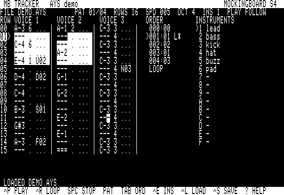
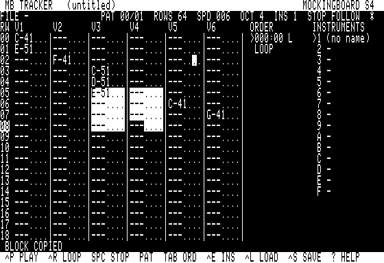
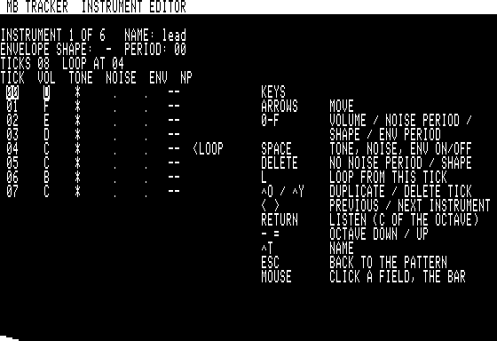

# MB TRACKER

Un tracker natif pour la **Mockingboard**, sur Apple //e enhanced ou //c
128 Ko (ProDOS 8, 80 colonnes). Il écrit et joue directement des fichiers
**AYS v1**, le format compact que les jeux du dépôt embarquent
([AYSONG_FORMAT.md](../dev/lib/apple2/AYSONG_FORMAT.md)) : ce qu'on entend
dans l'éditeur est ce que `aysong.asm` jouera dans le jeu, au registre près.
Il remplace MCS (éditeur façon *Music Construction Set* au haut-parleur).

<table><tr>
<td></td>
<td></td>
</tr><tr>
<td></td><td></td>
</tr></table>

**Lot 1 (2026-10-31)** : grille de motif, liste d'ordre, éditeur
d'instrument, lecture sous interruption à 50 Hz qui suit le curseur, muets
par voix, chargement / sauvegarde de fichiers `.AYS`, aide. Sans carte :
« NO MOCKINGBOARD », l'édition et les fichiers restent possibles.

**Lots M1-M4 (2026-10-31)** : la **souris** (pointeur, clics dans la grille,
la liste d'ordre, les instruments, la barre du bas ; glisser = un bloc) ;
les **blocs** (copier / couper / coller entre motifs, transposer d'un
demi-ton ou d'une octave, annuler / refaire) ; l'insertion, le clonage et
la suppression de motifs dans la liste d'ordre ; les **6 voix** (les deux
puces : choix à `^N`, grille de 6 colonnes) ; l'**import PT3** (Vortex
Tracker II) dans `dev/tools/audio/pt3import.py`, et sur la disquette
`WG.AYS`, la musique de WARGALAGA II importée.

## Écrans et touches

Le haut de l'écran : le nom du morceau et la carte (`MOCKINGBOARD S4`),
puis le fichier, le motif, les lignes, la vitesse, l'octave, l'instrument
courant, l'état (STOP / PLAY / LOOP, FOLLOW). Au centre la grille ; à droite
la liste d'ordre (`L` = point de bouclage, `*` = entrée jouée) et les 15
instruments. Ligne 22 : les messages ; ligne 23 : les touches principales.
`?` affiche toutes les touches.

Une cellule : `C-4 1 A47` = note, instrument (1-F), effet et paramètre
(hex). `---` vide (la note continue), `===` note coupée. À 6 voix la même
cellule s'écrit `C-41A47` (8 colonnes par voix : 6 × 8 + les numéros de
ligne = 51 colonnes, puis la liste d'ordre et les instruments).

| Touches (grille) | |
|---|---|
| flèches, `[` `]` | se déplacer (note, instrument, effet, paramètre ×2), 16 lignes |
| `Z S X D C V G B H N J M ,` | piano, octave courante (`,` = do suivant) |
| `Q 2 W 3 E R 5 T 6 Y 7 U I` | piano, octave + 1 |
| `1` | note coupée ; `Delete` ou `.` : efface le champ |
| `-` `=` | octave ; `<` `>` : instrument des notes saisies (écrit avec chaque note) |
| `0`-`F` | instrument, paramètre ; `O A U D F S N E` : effet (arrêt, arpège, glissés, fondu, crescendo, bruit, période d'enveloppe) |
| `^O` `^Y` | insérer / supprimer une ligne (toutes les voix) |
| `_` `+`, `{` `}` | vitesse (tics par ligne), lignes des motifs (1-64) |
| `^P`, `^R`, espace / `Esc` | jouer depuis l'entrée d'ordre courante, boucler le motif, arrêter |
| `^F` | suivre la lecture ; `! @ #` (`$ % ^`) : muet voix 1-3 (4-6) |
| `Tab` | liste d'ordre : `↑ ↓` entrée, `- =` / `← →` numéro de motif (au-delà du dernier : nouveau motif), `N` / `C` motif vide / copie (clone) pour cette entrée, `I` un nouveau motif inséré après elle, `D` supprimer son motif (ses entrées partent, les suivants sont renumérotés), `^O` `^Y` insérer / supprimer l'entrée, `L` boucle (à nouveau : arrêt en fin) |
| `^B` | marquer un bloc : de ce point au curseur (à nouveau, ou `Esc` : plus de bloc) |
| `^C` `^X` `^V` | copier / couper le bloc (sans bloc : la cellule du curseur), coller à son coin ou au curseur, dans n'importe quel motif |
| `;` `'` / `:` `"` | transposer le bloc d'un demi-ton / d'une octave, vers le bas / le haut |
| `^Z` | annuler la dernière modification de cellule ou de bloc (aussi `^O` `^Y`) ; à nouveau : refaire |
| `^E` | éditeur d'instrument |
| `^T` `^A` | nom du morceau, auteur |
| `^L` `^S` `^N` `^Q` | charger, sauver, nouveau (3 ou 6 voix : `Y` = 6), quitter vers ProDOS |

### Souris

Une carte AppleMouse sur le //e (n'importe quel slot sauf celui de la
Mockingboard), la souris du //c. Le pointeur est la cellule sous la souris,
montrée en inverse (en normal sur une cellule déjà inverse) ; le texte se
dessine dessous. Le clavier fait tout sans souris.

| Clic | |
|---|---|
| une cellule de la grille | le curseur sur ce champ (note, instrument, effet, paramètre) ; **glisser** depuis elle : un bloc |
| un numéro de ligne | cette ligne ; la première / la dernière affichée : 16 lignes plus haut / plus bas |
| une entrée de la liste d'ordre | cette entrée (la liste prend les touches) |
| un instrument | celui des notes saisies ; cliqué à nouveau : son éditeur |
| `VOICE n` (`Vn`) | muet / pas muet |
| la barre du bas | `PLAY` `LOOP` `STOP`, `PAT` / `ORD` (les touches à la grille / à la liste), `INS` (éditeur), `LOAD`, `SAVE`, `HELP` |
| éditeur d'instrument | un champ d'un tic ou de l'enveloppe ; la barre (`RETURN`, `ESC`, `<` `>`, `^T`, `^O`) |
| liste des fichiers | un nom le choisit, cliqué à nouveau il se charge ; la barre |

Sur le //e la souris est lue une fois par balayage (deux lectures de suite
perdent une partie du mouvement), aussi entre les lignes d'un long
réaffichage : un clic pendant un dessin est retenu là où il a eu lieu.

L'éditeur d'instrument (`^E`) : une ligne par tic (volume 0-F, ton, bruit,
enveloppe matérielle, période de bruit), le point de boucle (`L` ; sur le
dernier tic : tenue), la forme et la période d'enveloppe (ligne du haut),
`^O` / `^Y` dupliquer / supprimer un tic, `<` `>` instrument précédent /
suivant (au-delà : un nouveau), `Retour` fait entendre le do de l'octave,
`^T` le nom. Chaque note saisie dans la grille est aussi jouée seule.

Pendant la lecture, une modification réencode le morceau et la lecture
reprend à la ligne où elle en était (les voix se taisent jusqu'à leur
note suivante).

## Fichiers

`^S` demande un nom (`.AYS` ajouté s'il manque) et écrit un fichier BIN sur
le volume de démarrage ; `^L` liste les `.AYS` du volume (`/` : taper un
nom). La disquette porte `DEMO.AYS`, la démo de
[`dev/tools/audio/aysong.py`](../dev/tools/audio/aysong.py) (`--demo`),
générée au build. Les fichiers se relisent avec `aysong.py` (`decode`,
`--json`, `--frames`) et s'embarquent dans un jeu avec `--asm` ou tels
quels (`ays_init` A/Y = adresse).

L'encodeur (src/song.c) produit les mêmes octets que `aysong.encode()` :
en-tête, ordre, pistes (les pistes identiques partagées), blocs, table des
motifs, instruments, textes (nom, auteur, noms d'instruments). Un fichier
chargé puis réencodé redonne les mêmes octets s'il vient d'`aysong.py` ou
du tracker.

Limites : 64 motifs de 3 voix (32 de 6), 64 lignes, 15 instruments de 64
tics au plus, un morceau encodé de 12 Ko au plus. Le lecteur est compilé
à 6 voix (`AYSONG_VOICES=6`, `MB_IRQ_HUSH_BOTH=1` : `mb_hush` coupe les
deux puces) ; un tic de l'interruption coûte au plus 5 309 cycles (le
premier, les deux puces écrites), ensuite ~3 400 au pire, ~1 900 en
moyenne (mesuré par `tests/test_mbt.py`).

### Import PT3

    python3 dev/tools/audio/pt3import.py SONG.PT3 -o SONG.AYS --report
    python3 dev/tools/audio/aysong.py --import-pt3 SONG.PT3 -o SONG.AYS

Les samples deviennent des instruments (un par sample × volume de canal ×
enveloppe / bruit, 15 au plus), les ornements de la forme 0, x, y l'effet
`A`, la vitesse le pgcd des durées de ligne, les motifs sont recoupés à un
nombre de lignes commun ; le rapport (`--report`) compte ce qui ne passe
pas (portamento, vibrato, glissés d'enveloppe, décalages de hauteur des
samples, autres ornements, changements de volume en cours de note) et les
limites du tracker dépassées. `--clock apple` : la hauteur que joue
`dev/lib/apple2/pt3` sur la Mockingboard ; `native` : celle du
compositeur (1,77 / 2 MHz). `WG.AYS`, sur la disquette, est la musique de
WARGALAGA II (`../wargalagaii/tools/pt3.py`, la musique du dépôt, GPL-3.0)
importée avec `--rate 25 --to-50hz` (25 Hz dans le jeu, 50 Hz ici) :
198 octets, 1 motif de 64 lignes, 2 instruments, rien de perdu ; ses
registres = ceux du lecteur PT3 au demi-ton près (`--clock apple` : ~40
cents de l'écart du jeu, au pire 54). `dev/tests/test_pt3_import.py`
vérifie `pt3play.py` (le lecteur PT3 en Python) contre `pt3/` sous a2run,
puis l'import.

## //c

Le //c est servi par la **Mockingboard 4c** : `mb_detect` la réveille en
`$C403` avant tout, puis la souris est cherchée. Une fois réveillée, la 4c
répond sur toute la page `$C400-$C4FF`, par-dessus le firmware de la
souris du //c (POM2 le modélise ainsi, comme la carte réelle) : **avec une
4c, pas de souris**, le clavier fait tout. Sans carte, le //c a sa souris
(sans musique). Sur le //e, la Mockingboard et la carte AppleMouse
coexistent : la souris est interrogée (pas d'interruption), la musique
tourne sous l'interruption du timer de la VIA.

## Construction, lancement, tests

    make -C mbtracker            # ../dist/MBTRACKER.po (+ dist/woz/MBTRACKER.woz)
    make -C mbtracker run        # POM2, //e enhanced, Mockingboard en slot 4
    make -C mbtracker run-mouse  # POM2, //e, Mockingboard en slot 4, AppleMouse en slot 2
    make -C mbtracker run-iic    # POM2, //c
    make -C mbtracker test       # ~15 s

Le volume : `MBT.SYSTEM` (l'amorce `dev/lib/prodos/sysboot.s`), `MBT.SYS`
(le programme, lié pour `$2000`, sans relocation), `MBT.OVL` (les deux
recouvrements : l'éditeur d'instrument, les écrans de fichiers et le
décodeur), `MBT.HELP` (les pages d'aide, `tools/help.py`), `DEMO.AYS`,
`WG.AYS`.

`tests/test_mbt.py` (a2shot avec Mockingboard) : //e — démarrage (barre de
titre, carte en slot 4, grille lue sur les deux pages texte), saisie au
piano de notes, coupure, effet, paramètre, instrument édité, vitesse : les
octets de la grille et l'AYS encodé = `aysong.encode()` du même morceau
construit en Python ; `^P` : les écritures AY décodées des accès au VIA =
le `Player` Python tic par tic ; `^S` : `TEST.AYS` relu dans l'image disque
et décodé par `aysong.py` ; `^L` : `DEMO.AYS` listé et chargé (octets
identiques au fichier livré), réencodé identique et joué comme le modèle.
//c avec 4c : la même saisie et la même lecture. //e sans carte : le
message, une note saisie, `^P` refusé, la liste d'ordre, `^Q`.
Souris (//e, carte en slot 4, AppleMouse en slot 2 : `--mouse-slot=2`
d'a2shot ; des pas de 24 points, le bouton tenu 8 images, chaque
déplacement commencé juste après une lecture du programme) : clics sur
les champs, les instruments, l'éditeur d'instrument et sa barre ; un bloc
glissé, `^C`, un clic, `^V` ; `^B`, transpositions, `^Z` (annuler,
refaire), `^X` ; la barre (`PLAY` = le modèle Python, `STOP`, `ORD`,
`PAT`, `HELP`, `LOAD`) ; la liste d'ordre (`I`, `C`, clics, `D`) ; chaque
grille = le même morceau construit en Python. 6 voix (//e et //c avec
carte) : `^N`, des notes sur les deux puces, la lecture = le `Player`
(`max_voices` 6), le coût du tic ; `WG.AYS` chargé et joué comme le
modèle. //c avec 4c : pas de souris, tout au clavier ; //c sans carte :
sa souris (un clic, une note, `HELP`, `ORD`). 15 contrôles, ~15 s.

## Carte mémoire

| Zone | Contenu |
|---|---|
| main `$0800-$0EE2` | sauvegarde de la page zéro (crt0), tables de l'encodeur, morceau d'écoute |
| main `$1000-$1F41` | tampon OPEN, bloc de catalogue, préfixe, motif courant (`grid`) + motif de travail (aussi les noms de l'écran de chargement) (pages libres du bitmap ProDOS : les lectures MLI y sont permises) |
| main `$2000-$7A8F` | saut d'entrée, RODATA (≥ 512 o : le FORMAT de `/RAM` écrase `$2000-$21FF` à la sortie), crt0, code résident (18 Ko), données |
| main `$7A90-$7CEF` | libre (608 o) |
| main `$7CF0-$8DFF` | les recouvrements (4 368 o) : OVL1 l'éditeur d'instrument (3 495 o), OVL2 les écrans de fichiers + `files.c` + le décodeur AYS (4 358 o) |
| main `$8E00-$BDFF` | le morceau AYS (12 Ko), lu par le lecteur ; au démarrage, le transit de `MBT.HELP` et de `MBT.OVL` |
| main `$BE00-$BEFF` | pile C |
| aux `$0400-$07FF` | colonnes paires du texte 80 colonnes |
| aux `$0800-$97FF` | les motifs, 3 octets par cellule (`/RAM` déconnecté) |
| aux `$9800-$A3FF` | les pages d'aide (3 pages, un en-tête de 4 mots ; 2 909 o) |
| aux `$A400-$A87F` | le presse-papiers des blocs (6 voix × 64 lignes) |
| aux `$A880-$ACFF` | le motif gardé pour `^Z` |
| aux `$AD00-$BFFF` | libre (4,8 Ko) |
| aux LC banque 1 `$D000-$F21F` | les images des deux recouvrements (`lc_put` / `lc_get` : ALTZP, par 128 octets sous SEI) |

Code : `main.c` 10,5 Ko résident (grille, panneaux, souris, blocs, aide),
`insed.c` 3,4 Ko (OVL1), `fileui.c` + `files.c` 2,2 Ko et le décodeur de
`song.c` 2,1 Ko (OVL2), `song.c` 2,9 Ko résident (modèle, encodeur),
`mbt_asm.s` 2,7 Ko (Mockingboard, `mb_irq`, `aysong` à 6 voix, texte,
pointeur, copies aux et LC), `dev/lib/mouse` 0,3 Ko.

Suite : [TODO.md](TODO.md).
