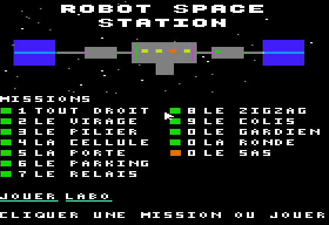
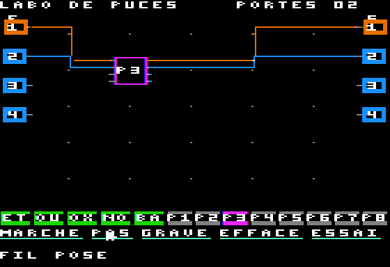
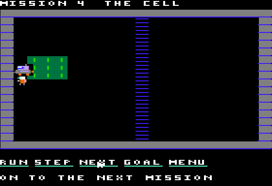

# ROBOT SPACE STATION

An original logic-wiring game for the Apple //e enhanced and //c (128 KB,
ProDOS, double hi-res, mouse). Stranded on an abandoned space station, a
technician programs maintenance drones with logic gates and chips of their
own making, walking into the drones to wire them.

<p align="center">


</p>
<p align="center">


</p>

Status: a title screen, the **chip lab**, the **test zone** and a first
sixteen **missions**, saved on the disk.

- **Lab**: place AND/OR/XOR/NOT/flip-flop parts and burned chips on a 5 × 5
  grid, wire them (orange = 1, blue = 0), toggle the inputs, run or step the
  simulation, burn the board into one of 8 chip slots, reopen a chip.
- **Test zone**: walk the technician into the drone, wire its bumpers,
  thrusters and claw (and your chips) from the inside, run it, watch it fly,
  get out.
- **Missions**: sixteen rooms, from "fly straight to the charger" to "fetch the
  energy cell behind the grate", then doors and pressure plates where the
  technician and the drone open the way for each other, two drones talking
  by radio, a zigzag down a shaft, a delivery through a held door, a
  drone parking beyond a grate for the technician, a round with a trap,
  an airlock of two doors, a crate carried onto a plate, a tandem
  where one drone calls the other, a shaft whose openings must be
  counted and a spiral of four headings. Burned chips,
  boards and progress are saved in `RSS.SAVE`.

The missions' rooms are read from the disk (`RSS.ROOMS`) when a mission
starts: adding missions costs disk space, not memory.

Rules and screens: [docs/SPEC.md](docs/SPEC.md) (French). The Python model
`tools/model.py` is the reference: the 6502 code matches it byte for byte.

```
make            # ../dist/ROBOTSTATION.po
make run        # POM2, //e enhanced, AppleMouse in slot 4
make run-iic    # POM2, //c
make test       # model, then lab and missions on //e and //c with a2shot (~1 min)
make test-long  # the whole campaign: every mission's solution in C == the model (~1 min)
```

Mouse or keyboard: arrows move the pointer, SPACE/RETURN clicks, ESC drops
what you hold, M run/pause, P one step, 1-9 and 0 pick a mission, H a hint
for the mission (on the title: the help page, also the AIDE button), V fast, S sound on/off, Ctrl-Q quits.
