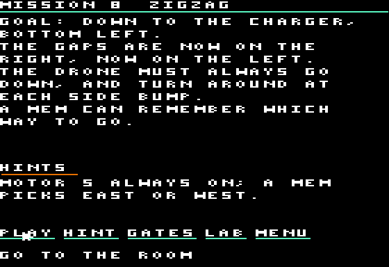
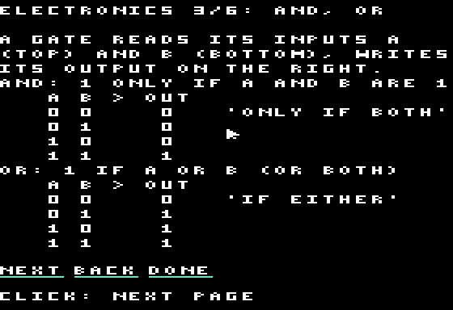

# ROBOT SPACE STATION

An original logic-wiring game for the Apple //e enhanced and //c (128 KB,
ProDOS, double hi-res, mouse). Stranded on an abandoned space station, a
technician programs maintenance drones with logic gates and chips of their
own making, walking into the drones to wire them.

<p align="center">


</p>
<p align="center">


</p>
<p align="center">


</p>

Status: a title screen, the **chip lab**, the **test zone** and a first
twenty **missions**, saved on the disk. Everything on screen is in English.

- **Briefings**: each mission opens on a page that says what to reach and
  what is new; HINT reveals a first, then a second hint, GATES opens the
  electronics course. GOAL (or H) brings it back from the room or a drone.
- **An electronics course** in the help: signals (1 orange, 0 blue), the
  sensors, the power, the motors, the toolbox step by step, each gate with
  its truth table, the memory (MEM) and the one-turn delay, recipes, the
  lab and chips, the keys. NEXT, BACK, DONE.
- **Power**: the "+" terminal, bottom left of every board, is always 1:
  one wire from + to MOTOR E and the drone flies east. Inside a burned chip,
  + is the board's own power.
- **The bottom line explains**: whatever the pointer is over (a sensor, a
  motor, a part, a pin, a button, a door, a plate...) is described there;
  over nothing, it says what to do next.
- **Lab**: take AND/OR/XOR/NOT/MEM (memory) parts and burned chips from
  the toolbox, place them on a 5 × 5 grid, wire them (orange = 1, blue = 0), toggle the inputs, run or
  step the simulation, burn the board into one of 8 chip slots, reopen a
  chip.
- **Test zone**: click the drone and the technician walks into it, wire its sensors,
  motors and claw (and your chips) from the inside, run it, watch it fly,
  get out: he steps out behind it, out of its way. Motors are named by
  where they send the drone: MOTOR E drives it east. The drones and the
  technician are drawn in profile, facing where they go.
- **Missions**: twenty rooms, from "fly straight to the charger" to doors
  and pressure plates where the technician and the drone open the way for
  each other, two drones talking by radio, a crate carried onto a plate, a
  shaft whose openings must be counted, a spiral, and floors where an XOR
  keeps the heading. Burned chips, boards and progress are saved in
  `RSS.SAVE`.

The missions' rooms are read from the disk (`RSS.ROOMS`) when a mission
starts, and every text (`tools/gen_text.py`: briefings, hints, help,
descriptions) is loaded at boot from `RSS.TEXT1/2` into auxiliary memory:
adding missions or words costs disk space, not main memory. The code of
the room and drones (PLAY) and of the title, help and briefings (FRONT) is
kept there too (`RSS.OVL`) and copied into the unused DHGR page 2 when a
screen of the other group opens (`src/overlay.s`, 0.11 s).

Rules and screens: [docs/SPEC.md](docs/SPEC.md) (French). The Python model
`tools/model.py` is the reference: the 6502 code matches it byte for byte.

```
make            # ../dist/ROBOTSTATION.po
make run        # POM2, //e enhanced, AppleMouse in slot 4
make run-iic    # POM2, //c
make test       # model, then lab and missions on //e and //c with a2shot (~1 min)
make test-long  # the whole campaign: every mission's solution in C == the model (~1 min)
```

Mouse or keyboard: arrows move the pointer, SPACE/RETURN clicks, ESC drops
what you hold, M run/pause, P one step, 1-9 and 0 pick a mission, H the
mission's briefing and hints (on the title: the help pages, also the HELP
button), V fast, S sound on/off, Ctrl-Q quits.
