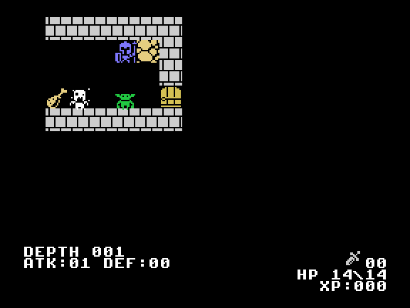
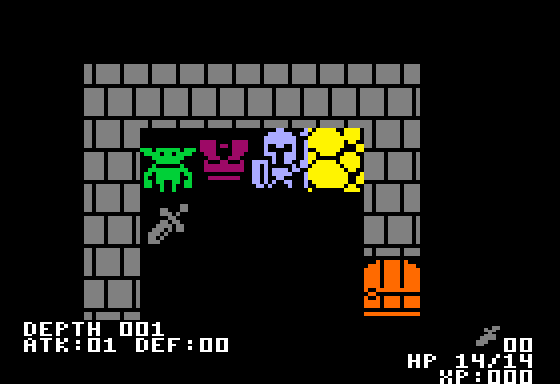
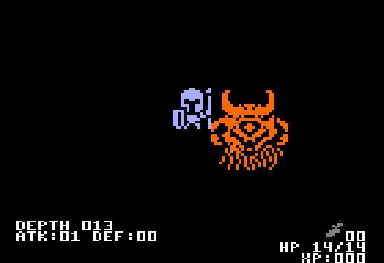
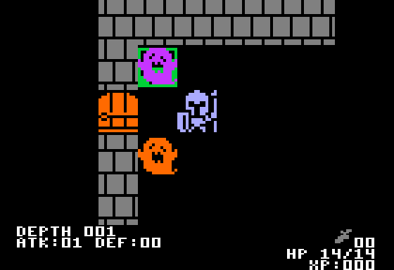
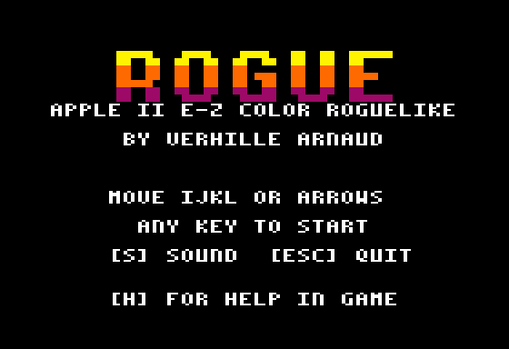

# ROGUE — Apple II + carte E-Z Color (TMS9918A), ou double haute résolution

Un roguelike « Berlin Interpretation » : 13 étages générés, champ de vision
à la torche (shadowcasting), cinq sortes de monstres puis le démon de la
profondeur 13, un sac de 26 objets, des bonus à durée (épée, tunique,
amulette, torche), des dagues à lancer, des fosses cachées, une seule vie.

C'est le `TMS_Rogue` de [POM1](https://github.com/habib256/pom1) (Apple-1 +
carte P-LAB TMS9918, `sketchs/tms9918/game_rogue`, même auteur), porté sur
Apple II avec la **E-Z Color Graphics Interface** de Steve Ciarcia (BYTE,
août 1982) : le même TMS9918A, son propre moniteur couleur. La logique du jeu
est celle de POM1 instruction pour instruction ; le portage a changé l'accès
au matériel, ajouté les sons, et séparé le jeu de son affichage pour qu'une
**version DHGR** (Apple //e 128 Ko ou //c, sans la carte) partage le même
cœur sur la même disquette.

    make            # -> ../dist/ROGUE.dsk (+ ../dist/woz/ROGUE.woz)
    make run        # POM2 en Apple II+ avec la carte dans l'emplacement 4
    make test       # lanceur, détection, VRAM, timing VDP, sons (~5 s)

## Quelle version démarre ?

`HELLO` lance `ROGUE`, un petit lanceur qui choisit :

1. **carte E-Z Color trouvée** (n'importe quel emplacement libre sauf le 3,
   détectée automatiquement ; l'emplacement du lecteur de démarrage n'est
   pas sondé) → `ROGUE.TMS`, sur tout Apple II (II+ 48 Ko suffit). L'écran
   Apple dit dans quel emplacement est la carte et rappelle les touches : **le
   jeu s'affiche sur le moniteur de la carte**.
2. **pas de carte, Apple //e 128 Ko ou //c** → `ROGUE.DHGR`, la version
   double haute résolution (section « Version DHGR » ci-dessous).
3. **ni l'un ni l'autre** (II, II+, //e 64 Ko sans carte) → un message clair
   sur l'écran Apple : ce dont ROGUE a besoin, comment brancher la carte,
   comment faire dans POM2 ; une touche rend le DOS.

## La version DHGR (Apple //e 128 Ko, //c)

`ROGUE.DHGR` est le même jeu (même cœur, mêmes touches, mêmes sons) affiché
sur l'écran de l'Apple en **double haute résolution couleur** (140 × 192
pixels de 16 couleurs) au lieu du moniteur de la carte. Il démarre seul sur un
//e 128 Ko ou un //c sans la carte (`BRUN ROGUE.DHGR` marche aussi).

Le donjon y est vu **à la manière de ROGUE X2**, la variante « ×2 en
couleur » du Rogue HGR de [POM1](https://github.com/habib256/pom1)
(`sketchs/gen2/game_rogue_x2`) : au lieu de la carte entière en petit (la
première version DHGR montrait l'image TMS divisée par deux en largeur :
[`screenshots/dhgr_old_halved.png`](screenshots/dhgr_old_halved.png), jugée
bien moins belle que la TMS9918), une **fenêtre de grandes cases** :

- **9 × 5 cases de 14 × 32 pixels** (126 × 160, lignes 0 à 159), une case =
  deux groupes de 7 pixels DHGR exactement (4 octets chacun) : chaque case
  s'écrit octet par octet, sans décalage. Une tuile ou un sprite TMS 16 × 16
  perd 2 colonnes (vides pour les sprites ; les bords pour les tuiles ; deux
  colonnes intérieures pour le mur, dont les briques restent espacées de 7)
  et double ses lignes : la même forme que sur la carte, deux fois plus
  grande ;
- **centrée sur l'aventurier**, qui reste dans la case du milieu (4, 2) :
  chaque pas fait défiler la fenêtre d'une case, elle peut déborder de la
  carte (cases noires) ; une action sans déplacement (coup, repos, vol de la
  dague, sac) la laisse en place. ROGUE X2 a 8 × 5 cases, le héros en
  (3, 2), une demi-case à gauche du centre ; 9 colonnes le mettent
  vraiment au milieu, avec 4 cases de chaque côté (le rayon de la torche
  éteinte est 3) ;
- **une couleur par entité**, celle de la table de ROGUE X2 transposée en
  DHGR pour les monstres et les tuiles ; les objets gardent leur couleur
  TMS9918, celle de leurs icônes dans le sac et le HUD (ROGUE X2 n'avait
  que les 4 teintes du HGR) ;
- un **coup reçu** colore le sprite en orange (le blanc pour ce qui est déjà
  orange : DEATH) le temps d'un tour, comme le rouge de la TMS9918 ;
- le **HUD** (lignes de texte 20 à 23), le **titre**, la **mission**, le
  **sac**, l'**aide**, la **mort**, la **victoire** restent l'image TMS
  divisée par deux (caractères 4 × 8, police 3 × 7 dessinée à la main) :
  32 colonnes de texte y tiennent ; le « ROGUE » du titre devient une
  grande bannière (lettres TMS ×2 en largeur, ×4 en hauteur, jaune → orange
  → rouge).

| Qui | Couleur DHGR | | Qui | Couleur DHGR |
|---|---|---|---|---|
| l'aventurier | bleu clair | | mur | gris |
| zombie (UNDEAD), troll | vert | | escalier | vert |
| fantôme | violet | | porte | orange |
| squelette | blanc | | fosse | violet |
| DEATH, le démon (2 × 2 cases) | orange | | éboulis (arche) | jaune |
| épée blanche, tunique magenta, amulette jaune, potion violette, parchemin aigue-marine, ration jaune, dague grise, torche rose | (TMS) | | sol, inconnu | noir |

**Double tampon.** Le jeu dessine chaque tour sur la **page DHGR cachée**
(seulement les cases dont le contenu a changé par rapport à ce que cette page
montre, puis ses lignes de HUD), puis la montre au **début du balayage
vertical** suivant (//e : `$C019` ; le //c n'a pas ce registre : la page
change aussitôt, une image peut se déchirer) : on ne voit jamais une image en
cours de dessin. Pendant que le jeu attend la touche suivante, l'autre page
rattrape la première (une touche l'interrompt : le tour passe avant) ; les
pages pleines (sac, aide…) sont dessinées sur la page montrée, octet par
octet à leur valeur finale.

**Mémoire.** Les deux pages DHGR prennent `$2000-$5FFF` (principale et
auxiliaire) : DOS 3.3 charge `ROGUE.DHGR` à `$3C00`, puis le jeu le
**libère** : le moteur d'affichage part dans la RAM de la carte langage
(`$D000-$F13D`, la ROM du moniteur recopiée en `$F800-$FFFF`), `$9600-$BFFF`
sert de BSS. Pour **sortir** (ESC au titre, ESC puis Y en jeu, Ctrl-RESET),
le jeu pose une marque et **redémarre la disquette** : son `HELLO` voit la
marque, dit « ROGUE: BYE! » et s'arrête au prompt BASIC, DOS 3.3 revenu
(la façon de DIRTBIKE). Détail dans [docs/PORT.md](docs/PORT.md) §3 et §6.

**Vitesse** (//e, `tests/test_dhgr.py`, mêmes donjons à chaque version) :
d'une touche à la nouvelle image affichée, un **pas** (la fenêtre défile)
prend 75 000 cycles en médiane (0,07 s), 92 000 pour 9 pas sur 10, au plus
109 000 ; une action sans pas (un coup) 5 000 en médiane (un mur : rien ne
change), 43 000 pour 9 sur 10 (un monstre : son flash, les monstres qui
bougent, le HUD) ; une page pleine (sac, aide) ~0,3 s comme avant. Le son et
le rattrapage de l'autre page viennent après l'image.

Tests : `tests/test_dhgr.py` (a2shot //e et //c, ~10 s, dans `make test`)
compare la page montrée, octet par octet et dans les deux banques, à l'image
que `tools/x2_dhgr.py` calcule depuis l'écran TMS virtuel (aussi la page
cachée à chaque attente de touche, et sur dix écrans virtuels au hasard dont
sept vues de jeu, la fenêtre au-delà de chaque bord), vérifie avec
`storewatch` que chaque octet de chaque page est écrit une seule fois par
mise à jour, que l'écran virtuel aux 89 points de contrôle est celui d'avant
(`tests/dhgr_screens.txt` : le cœur n'a pas changé), et sur `dist/ROGUE.dsk`
que ESC et Ctrl-RESET ramènent au BASIC ; `tools/profile_dhgr.py` dit où
passent les cycles d'un tour, `tools/shots_dhgr.py` refait les images
ci-dessus (chacune vérifiée contre le modèle).

## Touches

| Touche | Action |
|---|---|
| `I` `J` `K` `L`, flèches | se déplacer (← → sur tout Apple II, ↑ ↓ sur //e) ; foncer sur un monstre = l'attaquer |
| `B` | le sac ; une lettre `A`..`Z` utilise l'objet (épée, tunique, amulette, torche = bonus à durée ; ration, potion = soin ; parchemin = carte) |
| `T` | lancer une dague, puis une direction |
| `.` | se reposer un tour |
| `H` ou `?` | aide (sur l'écran de la carte) |
| `S` | son oui / non (aussi affiché sur l'écran Apple) |
| `ESC` | au titre : retour au DOS ; en jeu : « QUIT TO DOS? Y OR N » (`ROGUE.DHGR` : la disquette redémarre et s'arrête au BASIC, « ROGUE: BYE! ») |
| Ctrl-RESET | retour au DOS (`ROGUE.DHGR` : de même) |

Au titre, `B` (code caché de POM1) mène droit à la salle du démon.

## Sons

Sur le haut-parleur de l'Apple : mur heurté, porte, objet ramassé, coup
porté, monstre tué, dague lancée, bonus, soin, parchemin, morsure, fosse,
escalier, niveau gagné, salle du démon ; un air au titre, un glas à la mort,
une fanfare à la victoire. Le détail est dans [docs/PORT.md](docs/PORT.md).

## Dans POM2

    make run                                    # = POM2 --preset ii+ --slot 4=ezcolor ../dist/ROGUE.dsk

ou, dans POM2, *Slot Config* : carte `ezcolor` dans un emplacement libre, puis
*Display ▸ Card Monitor* pour voir le moniteur de la carte à côté de l'écran
Apple (ou l'écran principal sur « Card video »). `APPLE2_RUN_FLAGS` change
l'emplacement (`make run APPLE2_RUN_FLAGS="--slot 2=ezcolor"`).

Les tests tournent sur `a2run --ezcolor=N` (émulateur C du dépôt, rendu PNG
du VRAM par `dev/tools/tms9918.py`, `build/tests/*.png`) et, depuis le
2026-10-31 (cœur POM2 ba7f04da), sur la vraie carte de POM2 :
`tests/test_rogue_pom2.py` lance `a2shot --ezcolor=N` (fenêtre d'accès du
TMS9918A comme sur le silicium), photographie le moniteur de la carte
(`build/tests/pom2_*.png`), vérifie que le VRAM et les registres sont ceux
d'a2run octet pour octet (titre, premier donjon à graine fixée, 200 touches de
jeu) et qu'aucun accès n'est perdu (`vdp_dropped` = 0, aussi jusqu'à la
profondeur 2) ; la carte dans les emplacements 1, 2, 5, 7 (le 6 est au Disk
II), sans carte sur ][+ et sur //e 128K. Toujours de l'émulation, pas du
matériel réel.

## Documentation

- [docs/PORT.md](docs/PORT.md) — ce qui a changé depuis POM1, détection,
  sons, carte mémoire ;
- [docs/VIDEO_API.md](docs/VIDEO_API.md) — l'interface entre le cœur du jeu
  et ses deux affichages (TMS9918, DHGR) ;
- [TODO.md](TODO.md).

## Crédits

- Jeu : VERHILLE Arnaud (POM1, 2026), GPL-3.0. La vue DHGR reprend le
  dessin de ROGUE X2 (POM1, `sketchs/gen2/game_rogue_x2`, même auteur) :
  fenêtre centrée sur le héros, grandes cases, une couleur par entité.
- Tuiles et sprites : **SCROLL-O-SPRITES de Quale** (mai 2013, CC-BY-3.0),
  découpés par les outils de POM1 (`tileset_rogue.inc`, `sprite_pats.inc`).
- Démon de la profondeur 13 : Hexany Ives, *Monster Menagerie*
  (`creature_024.png`, CC0).
- Shadowcasting : Björn Bergström (RogueBasin, 2002).
- Carte E-Z Color Graphics Interface : Steve Ciarcia, BYTE, août 1982.
