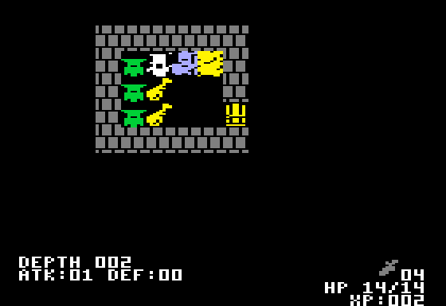
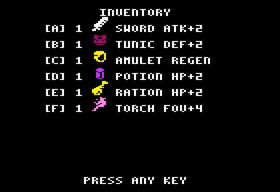

# ROGUE — Apple II + carte E-Z Color (TMS9918A), ou double haute résolution

Un roguelike « Berlin Interpretation » : 13 étages générés, champ de vision
à la torche (shadowcasting), cinq sortes de monstres puis le démon de la
profondeur 13, un sac de 26 objets, des bonus à durée (épée, tunique,
amulette, torche), des dagues à lancer, des fosses cachées, une seule vie.

C'est le `TMS_Rogue` de [POM1](https://github.com/habib256/pom1) (Apple-1 +
carte P-LAB TMS9918, `sketchs/tms9918/game_rogue`, même auteur), porté sur
Apple II avec la **E-Z Color Graphics Interface** de Steve Ciarcia (BYTE,
août 1982) : le même TMS9918A, son propre moniteur couleur. La logique du jeu
est celle de POM1 instruction pour instruction ; le portage a changé l'accès
au matériel, ajouté les sons, et séparé le jeu de son affichage pour qu'une
**version DHGR** (Apple //e 128 Ko ou //c, sans la carte) partage le même
cœur sur la même disquette.

    make            # -> ../dist/ROGUE.dsk (+ ../dist/woz/ROGUE.woz)
    make run        # POM2 en Apple II+ avec la carte dans l'emplacement 4
    make test       # lanceur, détection, VRAM, timing VDP, sons (~5 s)

## Quelle version démarre ?

`HELLO` lance `ROGUE`, un petit lanceur qui choisit :

1. **carte E-Z Color trouvée** (n'importe quel emplacement libre sauf le 3,
   détectée automatiquement ; l'emplacement du lecteur de démarrage n'est
   pas sondé) → `ROGUE.TMS`, sur tout Apple II (II+ 48 Ko suffit). L'écran
   Apple dit dans quel emplacement est la carte et rappelle les touches : **le
   jeu s'affiche sur le moniteur de la carte**.
2. **pas de carte, Apple //e 128 Ko ou //c** → `ROGUE.DHGR`, la version
   double haute résolution (section « Version DHGR » ci-dessous).
3. **ni l'un ni l'autre** (II, II+, //e 64 Ko sans carte) → un message clair
   sur l'écran Apple : ce dont ROGUE a besoin, comment brancher la carte,
   comment faire dans POM2 ; une touche rend le DOS.

## La version DHGR (Apple //e 128 Ko, //c)

`ROGUE.DHGR` est le même jeu (même cœur, mêmes touches, mêmes sons) affiché
sur l'écran de l'Apple en **double haute résolution couleur** (140 × 192
pixels de 16 couleurs) au lieu du moniteur de la carte. Il démarre seul sur un
//e 128 Ko ou un //c sans la carte (`BRUN ROGUE.DHGR` marche aussi).

Ce qui change par rapport à l'écran TMS9918 :

- **résolution** : l'image TMS (256 × 192) est **divisée par deux en
  largeur** : un pixel couleur DHGR = deux pixels TMS, une ligne = une ligne.
  L'écran du jeu fait 128 × 192 pixels au centre (6 pixels noirs de chaque
  côté) ; un caractère fait 4 × 8, une tuile de la carte 8 × 16, un sprite
  8 × 16. La disposition est **exactement** celle de la version TMS (carte
  16 × 10 tuiles, HUD sur les 4 lignes du bas, sac, aide, titre) ;
- **tuiles et sprites** : convertis par `tools/tiles_dhgr.py` (deux pixels TMS
  → un : le mur et la porte gardent un pixel si les deux sont allumés, ce qui
  garde le joint des briques ; les autres tuiles et les sprites si l'un des
  deux l'est, ce qui garde les traits fins) ; **police 3 × 7** dessinée à la
  main (les lettres TMS réduites étaient illisibles), 32 colonnes ;
- **couleurs** : chaque couleur TMS9918 a son équivalent DHGR (table
  ci-dessous) ; le flash du coup reçu est **orange** (le rouge moyen TMS) ;
- **pas de sprites matériels** : le dos de l'écran (`video_dhgr.asm`) garde
  une copie de l'écran TMS virtuel et ne redessine, quand le jeu attend une
  touche, que les groupes de 7 pixels qui ont changé, composés directement
  en octets de l'écran (tuiles par tables précalculées, puis sprites ;
  chaque octet de l'écran écrit une fois, sa valeur finale : pas de
  scintillement) ; pas de limite de 4 sprites par ligne ;
- **vitesse** : un tour ordinaire prend environ 0,04 s (médiane, jeu + son +
  dessin, 0,06 s torche allumée ; l'image paraît avant le son, et 9 tours
  sur 10 l'affichent en moins de 0,1 s), un écran entier (nouvel étage,
  sac, aide) 0,33 s (détail, avant / après, dans
  [docs/PORT.md](docs/PORT.md) §3.1).

| TMS9918 | DHGR | Qui |
|---|---|---|
| 2, 3 verts | 12 vert | troll |
| 4 bleu foncé | 6 bleu moyen | — |
| 5 bleu clair | 7 bleu clair | l'aventurier |
| 6 rouge foncé | 1 magenta (rouge profond) | tunique |
| 7 cyan | 14 aigue-marine | squelette, parchemin |
| 8 rouge moyen | 9 orange | coup reçu, démon |
| 9 rouge clair | 11 rose | torche |
| 10, 11 jaunes | 13 jaune | escaliers, porte, fosse, DEATH, amulette, ration |
| 12 vert foncé | 4 vert foncé | — |
| 13 magenta | 3 violet | potion |
| 14 gris | 5 gris | murs, fantôme, dague |
| 15 blanc | 15 blanc | texte, zombie, épée |

Une variante **monochrome 560 points** (l'image TMS à l'identique, deux
points par pixel, très nette) a été essayée
([`screenshots/dhgr_mock_mono.png`](screenshots/dhgr_mock_mono.png), face à
[`dhgr_mock.png`](screenshots/dhgr_mock.png) et à l'original
[`dhgr_mock_tms.png`](screenshots/dhgr_mock_tms.png)) : elle perd toutes les
couleurs (monstres, flash rouge) et frange sur un moniteur couleur. La
version couleur, lisible, est la seule livrée.

Mémoire : DOS 3.3 gardé, page DHGR 1 (`$2000-$3FFF`, banques principale et
auxiliaire), le reste en mémoire principale (détail dans
[docs/PORT.md](docs/PORT.md)). Tests : `tests/test_dhgr.py` (a2shot //e et
//c, ~4 s, dans `make test`) compare chaque écran, octet par octet, à l'image
que l'outil calcule depuis l'écran TMS virtuel (aussi sur trois écrans
virtuels au hasard), et vérifie avec `storewatch` que chaque octet est écrit
une seule fois, et que l'écran virtuel aux 89 points de contrôle est celui
d'avant les optimisations du 2026-10-31 (`tests/dhgr_screens.txt`) ;
`tools/profile_dhgr.py` dit où passent les cycles d'un tour.

## Touches

| Touche | Action |
|---|---|
| `I` `J` `K` `L`, flèches | se déplacer (← → sur tout Apple II, ↑ ↓ sur //e) ; foncer sur un monstre = l'attaquer |
| `B` | le sac ; une lettre `A`..`Z` utilise l'objet (épée, tunique, amulette, torche = bonus à durée ; ration, potion = soin ; parchemin = carte) |
| `T` | lancer une dague, puis une direction |
| `.` | se reposer un tour |
| `H` ou `?` | aide (sur l'écran de la carte) |
| `S` | son oui / non (aussi affiché sur l'écran Apple) |
| `ESC` | au titre : retour au DOS ; en jeu : « QUIT TO DOS? Y OR N » |
| Ctrl-RESET | retour au DOS |

Au titre, `B` (code caché de POM1) mène droit à la salle du démon.

## Sons

Sur le haut-parleur de l'Apple : mur heurté, porte, objet ramassé, coup
porté, monstre tué, dague lancée, bonus, soin, parchemin, morsure, fosse,
escalier, niveau gagné, salle du démon ; un air au titre, un glas à la mort,
une fanfare à la victoire. Le détail est dans [docs/PORT.md](docs/PORT.md).

## Dans POM2

    make run                                    # = POM2 --preset ii+ --slot 4=ezcolor ../dist/ROGUE.dsk

ou, dans POM2, *Slot Config* : carte `ezcolor` dans un emplacement libre, puis
*Display ▸ Card Monitor* pour voir le moniteur de la carte à côté de l'écran
Apple (ou l'écran principal sur « Card video »). `APPLE2_RUN_FLAGS` change
l'emplacement (`make run APPLE2_RUN_FLAGS="--slot 2=ezcolor"`).

Les tests tournent sur `a2run --ezcolor=N` (émulateur C du dépôt, rendu PNG
du VRAM par `dev/tools/tms9918.py`, `build/tests/*.png`) et, depuis le
2026-10-31 (cœur POM2 ba7f04da), sur la vraie carte de POM2 :
`tests/test_rogue_pom2.py` lance `a2shot --ezcolor=N` (fenêtre d'accès du
TMS9918A comme sur le silicium), photographie le moniteur de la carte
(`build/tests/pom2_*.png`), vérifie que le VRAM et les registres sont ceux
d'a2run octet pour octet (titre, premier donjon à graine fixée, 200 touches de
jeu) et qu'aucun accès n'est perdu (`vdp_dropped` = 0, aussi jusqu'à la
profondeur 2) ; la carte dans les emplacements 1, 2, 5, 7 (le 6 est au Disk
II), sans carte sur ][+ et sur //e 128K. Toujours de l'émulation, pas du
matériel réel.

## Documentation

- [docs/PORT.md](docs/PORT.md) — ce qui a changé depuis POM1, détection,
  sons, carte mémoire ;
- [docs/VIDEO_API.md](docs/VIDEO_API.md) — l'interface entre le cœur du jeu
  et ses deux affichages (TMS9918, DHGR) ;
- [TODO.md](TODO.md).

## Crédits

- Jeu : VERHILLE Arnaud (POM1, 2026), GPL-3.0.
- Tuiles et sprites : **SCROLL-O-SPRITES de Quale** (mai 2013, CC-BY-3.0),
  découpés par les outils de POM1 (`tileset_rogue.inc`, `sprite_pats.inc`).
- Démon de la profondeur 13 : Hexany Ives, *Monster Menagerie*
  (`creature_024.png`, CC0).
- Shadowcasting : Björn Bergström (RogueBasin, 2002).
- Carte E-Z Color Graphics Interface : Steve Ciarcia, BYTE, août 1982.
