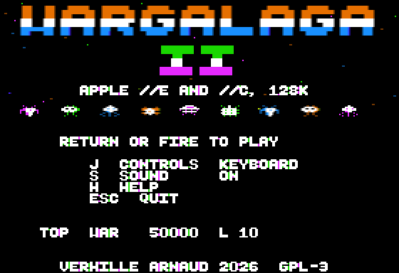
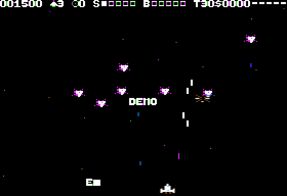

# WARGALAGA II

<table><tr>
<td></td>
<td></td>
</tr></table>

**Lots 1 à 9 faits (2026-10-23)**, reste la validation sur vraies machines —
démarrage ProDOS, horloge
VBL, étoiles, vaisseau et tirs, 40 aliens qui entrent en vagues, se posent
en formation qui respire, plongent et bombardent ; collisions, explosions,
vies, armure, score et HUD, GAME OVER, à 30 i/s ; son (musique PT3 et
bruitages sur Mockingboard, bruitages au haut-parleur, S coupe) ; 32 bonus
qui tombent (une forme par famille, [aperçu](screenshots/bonus.png) ; au ramassage, son nom
au milieu du terrain et un son, bonus ou malus), jauges S/B/T, armes double et triple, tir automatique, ×2/×5,
bouclier, gel ; 100 niveaux en paquets, boss, soucoupe ; boutique et rangs ;
sous-jeux Meteor Storm et Memory Station ; écran titre (image LZ4FH,
menu, aide), **mode démo** qui rejoue une partie de l'autopilote, records
`HIGHSCORES` avec initiales, choix clavier / manette retenu. Plan et état :
[`TODO.md`](TODO.md) ; référence du jeu modèle :
[`docs/warblade-reference.md`](docs/warblade-reference.md).

    make            # ../dist/WARGALAGAII.po
    make run        # POM2, //e enhanced
    make run-iic    # POM2, //c
    make test       # ~5 min : volume, cadence NTSC/PAL, oracles, banc, écrans, son, boutique, sous-jeux, titre, démo, records
    python3 tools/profile.py [--shots 10]   # cycles par image et par routine

Shoot'em up fixe dans l'esprit de **Warblade** (Edgar M. Vigdal, PC/Mac 2003),
lui-même réécriture de son *Deluxe Galaga* (Amiga, années 1990) : vaisseau
en bas de l'écran, gauche/droite seulement, aliens qui entrent en vague, se
rangent en formation puis plongent ; pièces et bonus qui tombent, boutique
tous les 4 niveaux, boss tous les 25, 100 niveaux qui bouclent plus durs,
rangs gagnés avec 6 marques de couleur, sous-jeux Meteor Storm et Memory
Station. Ce n'est **pas un portage** : aucun code ni aucune donnée de
Warblade n'est repris ; on reprend les règles, réduites à ce que tient un
Apple II.

Sources cherchées pour « WarGalaga » : rien sous ce nom dans ce dépôt, dans
`~/src` ni dans [POM1](https://github.com/habib256/pom1). POM1 a en revanche
un **TMS Galaga** (`sketchs/tms9918/game_galaga/TMS_Galaga.asm`, 5 127 lignes,
carte TMS9918, sprites matériels) : 3 aliens à la fois, 4 plongées
(droite, zigzag, diagonale, boucle), formation qui oscille, super boss tirant
en rosace (table d'angles), bonus double/triple/bouclier/crâne. Il ne se
porte pas (tout repose sur les 32 sprites matériels du TMS9918), mais ses
plongées et son réglage par vague servent de point de départ aux tables.

## Machine cible

**Apple //e enhanced ou //c, 128 Ko, 65C02, ProDOS 8** (choix de
l'utilisateur, 2026-10-22). Pas de version II+. Même profil que
[CHROMABREAK](../chromabreak/README.md), dont on reprend l'amorce, le
démarrage et la cadence.

- **65C02 exigé** (`STZ`, `BRA`, `PHX/PLX`, `(zp)`, `TRB/TSB`, mode décimal
  fiable pour le score BCD) : //e *enhanced* ou //c. Une //e non améliorée
  (NMOS) reçoit un message au démarrage et rend la main, comme
  CHROMABREAK (`dev/lib/prodos/sysboot.s`, test `INC A` = `NOP` sur NMOS). IIgs : non visé
  (polarité VBL différente, `apple2frame` l'exclut) ; s'il démarre, tant
  mieux, sans test.
- **128 Ko** : la mémoire auxiliaire sert de réserve (dessins d'aliens et
  leurs variantes de couleur, trajectoires, musiques PT3, écrans), copiée en
  mémoire principale entre deux niveaux. `/RAM` est réclamé au démarrage et
  reformaté à la sortie (`dev/lib/prodos/video.s`,
  `PD_VIDEO_DISCARD_RAM`, comme CHROMABREAK).
- **ProDOS** plutôt que DOS 3.3 : 128 Ko, gestionnaire d'interruptions
  officiel (`ALLOC_INTERRUPT`, nécessaire pour l'interruption VBL du //c
  et pour la Mockingboard), fichiers de scores simples, volume **140 Ko**
  (`.po`, 280 blocs : décision du 2026-10-22, pas de 800 Ko).

### HGR partout, DHGR plus tard

| | HGR (280×192, 6 couleurs) | DHGR (140×192, 16 couleurs) |
|---|---|---|
| Octets par ligne | 40, une banque | 80, moitié principale / moitié auxiliaire |
| Même surface de sprite | 1× | ~2× les octets, plus 2 bascules de banque (`$C054/$C055` avec 80STORE) par ligne |
| Effacement d'une page (bench) | 51 514 cycles | 207 865 (chemin C, lot 4 en cours) |
| Petit sprite (bench, chemins C) | `hgr_blit7` 4×8 : 1 708 | `dhgr_sprite` 2×2 masqué : 5 158 |
| Lu par les données en mémoire aux | oui (la vidéo n'y est pas) | non : la vidéo occupe aux `$2000-$5FFF` |

Estimation pour un alien de 14×10 points HGR (3 octets par ligne une fois
prédécalé) : ~600 cycles pour le dessiner en `ORA` sur fond noir, ~400 pour
l'effacer (`STA` de zéros), soit ~1 000 par alien qui bouge et par image.
Le même alien en DHGR coûte ~2 000-2 200. Avec le budget d'une image à
30 i/s (ci-dessous), HGR fait bouger ~18 aliens par image, DHGR ~8-9.
**Choix (2026-10-22) : HGR double tampon partout**, jeu comme écrans fixes
(titre, boutique, Memory Station). La DHGR 16 couleurs des écrans fixes
est remise à **plus tard** ; elle prendrait aux `$2000-$5FFF` à la réserve.

Couleurs HGR : les sprites colorés se déplacent par pas de 2 points (la
couleur dépend de la parité de colonne) ; sept prédécalages couvrent un
groupe de 14 points (2 octets), chacun avec le bon bit de palette par octet
(note `x = 14*n` de `dev/lib/hgrc`). Le fond est noir avec des étoiles :
pas de sauvegarde du fond sous les sprites. La formation posée est tracée en
`STA` et effacée en zéros ; ce qui vole (plongeurs, tirs) est tracé et
effacé en `EOR`, dans l'ordre inverse du tracé, ce qui rend la formation
dessous intacte sans la redessiner (lot 2, `src/render.s`).

### Aliens : peu de dessins, plusieurs couleurs

Au départ **6 dessins de petits aliens, 2 de gros aliens (niveau 3 de chaque
paquet, porteurs des marques de rang) et 1 boss**, chacun en **4 teintes** :
les 25 paquets de 4 niveaux prennent le dessin `n mod 6` et la teinte
`n div 6` (24 combinaisons ; le boss garde sa teinte par niveau 25/50/75/100).
D'autres dessins plus tard.

En HGR, une teinte n'est pas un attribut : un point coloré est un point
allumé sur une colonne paire ou impaire, et le bit 7 de chaque octet choisit
le groupe (0 : violet / vert ; 1 : bleu / orange) ; deux points voisins
allumés donnent du blanc. Le dessin est donc tracé en « cellules » de
2 points (forme) et `tools/sprites.py` en tire les 4 teintes : violet =
point de gauche de chaque cellule, vert = point de droite, bit 7 à 0 ;
bleu et orange idem avec bit 7 à 1. Le blanc (les deux points) reste
disponible pour les reflets ; un même octet ne peut mélanger les deux
groupes. Les teintes sont **précalculées**, pas appliquées au dessin par un
`AND` (+3 cycles par octet, ~90 par alien, ~9 % du rendu des aliens).

Coût des tables : petit alien 14×10, 3 octets × 10 lignes × 7 phases ×
2 images d'animation = **420 octets** par dessin et par teinte ; 6 × 4 =
10 Ko. Gros alien 21×16 : 4 × 16 × 7 × 2 = 896 octets, 2 × 4 = 7 Ko.
Tout est rangé en mémoire aux ; seul le jeu du paquet courant (un petit,
un gros, ~1,3 Ko) est copié en `$1300-$1FFF` à chaque téléportation, avec le
vaisseau, les tirs et les bonus (~1,5 Ko).

### Cadence

Une image = **2 rafraîchissements** : 30 i/s NTSC, 25 PAL (comme
CHROMABREAK ; le jeu est donc ~17 % plus lent en PAL, c'est accepté : pas
de vitesses recalculées par seconde). Le faisceau mesure
17 030 cycles par rafraîchissement NTSC (20 280 PAL) ; le budget du dépôt
(`dev/bench/budgets.json`) en garde 2 × 17 030 − 6 000 = **28 060** pour le
rendu et la logique, les 6 000 réservés couvrant la musique et l'horloge
sous IRQ. Répartition visée (NTSC) :

| Poste | Cycles |
|---|---:|
| Logique : formation, plongées, tirs, collisions, bonus | ~5 000 |
| Vaisseau + ~10 tirs + ~6 objets qui tombent | ~3 000 |
| Étoiles (~24, 1 octet chacune, effacer + poser) | ~1 500 |
| HUD : un chiffre au plus par image (`hgr_hud8` : 7 850 pour 5 chiffres) | ~1 000 |
| Aliens : ~18 qui bougent à ~1 000 | ~17 500 |
| **Total** | **~28 000** |

La formation « respire » par petits pas : une rangée bouge par image, les
autres restent en place (règle « ne redessiner que ce qui change »). Plus
de ~18 aliens en mouvement (boss, vagues kamikaze) : on passe en 3
rafraîchissements par image (20 i/s, 45 090 cycles utiles) **sans changer la
vitesse du jeu**, car la logique avance d'un pas fixe par paire de
rafraîchissements, comptés par l'horloge (VBL), pas par image dessinée.

L'horloge vient du VBL : scrutation de `RDVBLBAR` (`$C019`, bit 7 à 0
pendant le VBL) sur //e (`apple2frame`). Le //c n'a pas de VBL lisible de
la même façon (`$C019` y est un drapeau d'interruption verrouillé) : on
prend l'**interruption VBL du firmware souris intégré** (mode 9,
`dev/lib/apple2c/apple2vbl.s`, commun avec CHROMABREAK, et `dev/lib/mouse`). C'est une source de temps,
pas une entrée : la souris n'est jamais lue. Alternative écartée :
programmer l'IOU soi-même (`$C05B`, acquittement par `$C070`) ; la ROM
du //c sert déjà ces interruptions par le firmware souris, et le chemin
mode 9 est celui que CHROMABREAK a testé sur les ROM 16 et 32 Ko. L'horloge
ne dépend ni du son ni de la carte présente.

### Son : avec ou sans Mockingboard

La Mockingboard est **facultative**. `mb_detect`
(`dev/lib/apple2/mockingboard.asm`) cherche une carte au démarrage, slots
7 à 1 sur //e, et la **Mockingboard 4c** sur //c (carte interne d'Ian Kim,
2016, vue en slot 4 : la détection la réveille à `$C403` et peut masquer la
ROM souris du slot 4, donc détecter **avant** d'installer l'horloge VBL du
//c ; que ce VBL reste utilisable avec une 4c est **à vérifier sur
machine**).

- Avec carte (`src/sound.s`) : musique **PT3** sur la première puce AY —
  module écrit par `tools/pt3.py` (morceau original de `tools/sound.py`),
  joué par le lecteur de Vince Weaver (`dev/lib/apple2/pt3/`, 0BSD) ; lecteur
  et morceau en **mémoire aux à `$6000`**, appelés par l'interruption du
  timer 1 de la VIA à 25 Hz (`MUS_HZ`, tempo indépendant des images et du
  PAL) via des trampolines à `$1FE0` ; bruitages sur la seconde puce.
- Sans carte : haut-parleur. **En jeu, bruitages seulement**, non
  bloquants, joués **dans l'attente du VBL** avant la bascule (le temps
  libre de l'image, jamais plus) ; **musique seulement hors jeu** (titre,
  boutique, fins), à deux voix (`duet`), où elle peut bloquer (décision du
  2026-10-22).

Le jeu se joue et va à la même vitesse dans les deux cas.

Pas de voix numérisées : `dev/lib/audio` (`sample_player.s`) est bloquant ;
au mieux un très court échantillon hors jeu (un mot au titre).

### Commandes

| Clavier | Manette | Effet |
|---|---|---|
| ← → (ou J / L) | X | déplacer le vaisseau |
| Pomme ouverte, ESPACE | bouton 0 | tirer (tir automatique si acheté) |
| Pomme fermée | bouton 1 | missiles, si on en a |
| ↑ ↓ ← → RETURN (ou ESPACE), ESC | Y, bouton 0 | boutique (← ↑ monter, → ↓ descendre, ESC : sortir) |
| ↑ ↓ ← → (ou I K J L), RETURN (ou ESPACE), ESC | X, Y, bouton 0 | Memory Station (retourner une carte, ESC : sortir) |
| Pomme ouverte, ESPACE tenus | bouton 0 tenu | Meteor Storm : accélérer (relâcher : ralentir) |
| ESC | | en jeu : retour au titre (record possible) ; au titre : quitter vers ProDOS |
| S | | son coupé / remis (en jeu et au titre) |
| TAB | | en jeu : clavier ↔ manette |
| RETURN, ESPACE | bouton 0 | titre : jouer |
| J (ou TAB), H | | titre : clavier ↔ manette (retenu dans `HIGHSCORES`), aide |
| lettres, chiffres, `.`, ← ou DELETE, RETURN | Y, bouton 0 | initiales d'un record (3 caractères) |

Titre : le menu reste ~10 s, puis les records ~8 s, puis le **mode démo**
(une partie du niveau 1 au début du 4, ~1 min, « DEMO » au milieu) ; une
touche ou un bouton revient au titre. GAME OVER : le titre après le tir ou
~8 s, avec la saisie des initiales si le score entre dans les 8 records.

Pas de souris : elle n'apporte rien à ce jeu (choix du 2026-10-22).

Sur //e, les touches tenues se lisent : `$C010` bit 7 (une touche est
enfoncée) et les boutons/pommes `$C061/$C062` en continu, donc gauche/droite
se tiennent sans attendre l'auto-répétition. La manette est lue pendant
l'attente du VBL (temps de lecture des paddles jusqu'à ~3 ms, compté comme
dans `chromabreak/src/timing.s`). Manette : port jeu du //e, prise DB-9 du
//c.

## Mémoire (prévue)

Configuration de liens : `dev/cc65/apple2_dhgr_prodos_c.cfg` convient telle
quelle (les pages `$2000-$5FFF` principales sont les deux pages HGR ; on
n'écrit pas les pages aux).

| Zone | Usage |
|---|---|
| `$0050-$00CF` | page zéro du jeu et de cc65 (`ZP` du cfg) ; le gestionnaire IRQ n'utilise ni la ZP cc65 ni sa pile |
| `$00D0-$00EF` | page zéro du lecteur PT3 (gardée entre deux ticks) |
| `$0200-$03FF` | libre ; page 3 : lecteur haut-parleur prévu (boucle à cycles comptés, sans franchir de page) |
| `$0400-$07FF` | page texte 1, jamais affichée en jeu : tables (en évitant les trous `$x78-$x7F`, `$xF8-$xFF`) |
| `$0800-$0FFF` | code de Meteor Storm (`storm.s`) et lecteur du mode démo avec son script (`demo.s`, `demo.inc`), textes des ramassages (`bonus.inc`, segment `PICK`), zone `LOWM`, copiés de `WG2.AUX` au démarrage ; le crt0 protège cette zone |
| `$1000-$12FF` | tables de lignes `hgr_lo`, `hgr_hi`, `hgr_hi2` alignées sur une page (segment `ROWS`) |
| `$1300-$1FDF` | tampon ProDOS (`IOBUF` : démarrage, `HIGHSCORES`), `LOWBSS` : sprites prédécalés du paquet courant, la table des records (`rec_buf`) |
| `$1FE0-$1FFF` | trampolines vers la mémoire aux (mêmes octets en aux) |
| `$2000-$3FFF`, `$4000-$5FFF` | pages HGR 1 et 2 |
| `$6000-$BDFF` | code, données, BSS (~23,5 Ko) |
| `$BE00-$BEFF` | pile C ; `$BF00` page globale ProDOS |
| aux `$2000-$5B7F` | `WG2.AUX` : dessins × teintes des paquets (15 232 octets, copie par `AUXMOVE` `$C311` entre deux niveaux) |
| aux `$6000-$6C55` | lecteur PT3 et morceau ; trampolines en aux `$1FE0` |
| aux `$7000-$8FFF` | overlay : boutique et Memory Station (copiés en `$4000` à l'ouverture, jusqu'au lecteur `duet`), puis l'écran titre avec son image LZ4FH (792 octets) et le décodeur (overlay entier copié à chaque titre) |
| aux `$9000-…` | code de Meteor Storm, du mode démo et textes des ramassages (fin de `WG2.AUX`), copié en `$0800` au démarrage |

## Disquette

`dist/WARGALAGAII.po`, volume `/WARGALAGAII` (11 caractères, nom ProDOS
valide). `WARGALAGA.SYSTEM` ferait 16 caractères, un de trop : l'amorce
s'appelle `WG2.SYSTEM`, le programme `WG2.SYS` (même schéma que
`CHROMA.SYSTEM` / `CHROMA.SYS`), plus `HIGHSCORES` (64 octets, format dans
`tools/records.py` : 8 records, la manette choisie ; recréé s'il manque, une
disquette protégée donne seulement un message) et les données aux
(`WG2.AUX` : paquets, PT3, overlay, tempête et démo).

Auteur : VERHILLE Arnaud. Licence : [GPL-3.0](../LICENSE). Warblade est une
œuvre d'Edgar M. Vigdal (EMV Software) ; rien n'en est repris.
